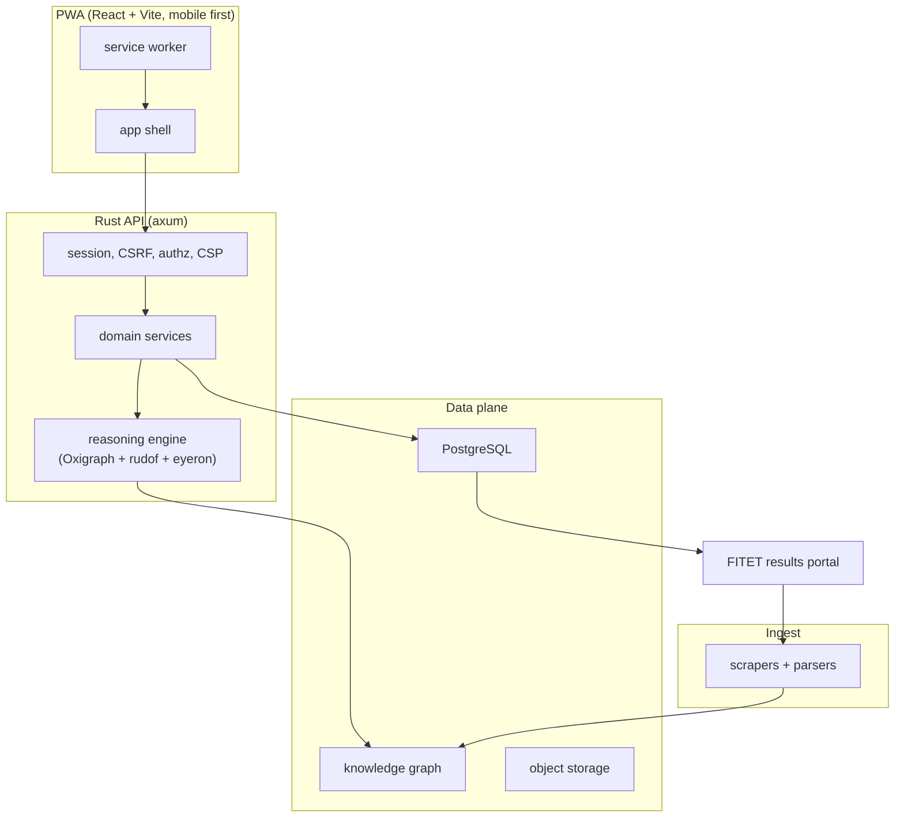

# Fantatt

**Fantasy table tennis.** Build squads from real FITET players, score points from
real results, and compete in leagues that run all season.

Rust backend · knowledge-graph game logic · verifiable reasoning rules ·
mobile-first PWA · Nix from top to bottom · no vendor lock-in.

---

## What it is

Managers assemble a monthly squad of 15 players across five division tiers
(B2 → D2) and score fantasy points from real match results in the Italian
regional and national championships. The same platform also runs a tournament
predictor mode for Open, Top, and Italian Championship brackets.

Game logic lives in a **knowledge graph**, evaluated by **reasoning rules**.
Every score, every rejected bid, every locked roster is a decision a rule
engine made, and it can be re-run and independently checked.

## Highlights

| | |
|---|---|
| **Two game modes** | Season-long fantasy championship + tournament prediction |
| **Knowledge graph** | Game state as RDF triples, queried with SPARQL |
| **Rule engine** | Game logic as versioned, content-addressed rule bundles |
| **Proofs** | Critical decisions emit checkable proof certificates |
| **Correct under concurrency** | Serialized isolation plus rule verdicts for auctions |
| **Live results** | Scraped and published within minutes, pushed over SSE and Web Push |
| **Offline PWA** | Installable, cache-first, delivers app updates through a prompt |
| **Mobile first** | Every screen designed from 360 px up, 44 px touch targets |
| **Passkeys** | Primary login, plus Google OAuth for onboarding |
| **GDPR ready** | Self-service export, deletion with a grace window, versioned consents |
| **Reproducible** | `nix develop` gives the whole toolchain; `nix flake check` runs everything |
| **Deployable anywhere** | A NixOS module, a container image, or a serverless recipe |

## Quick start

```bash
nix develop            # complete toolchain: Rust, Node, browsers, test binaries
nix flake check        # build, lint, audit, test, VM integration suite
just test              # unit + integration
just e2e               # browser flows against a local stack
```

Deploy the whole stack on a NixOS machine:

```nix
{
  imports = [ inputs.fantatt.nixosModules.fantatt ];
  services.fantatt = {
    enable = true;
    domain = "fantatt.example.org";
    observability.createLocally = true;   # Prometheus, Grafana, Loki, Tempo
  };
}
```

## The game in one page

**Roster.** 15 players per month: 10 starters and 5 bench, arranged as
2 starters + 1 bench in each of B2, C1, C2, D1, D2. Locked for the month once
submitted.

**Scoring.** Base points by tier for a win (B2 15 → D2 6), multiplied by away
matches (×1.2), a comeback win from 0–2 (×1.3), and deciding the tie at 3–3
(×1.3). Beating a much stronger opponent multiplies further; doubles are halved
and exempt from the rating multiplier. Team victory adds 3, a doubles in the
same matchday adds 2.

**Substitutions.** An absent starter is automatically replaced by the bench
player **in the same tier**.

**Standings.** Matchday → monthly standings → monthly winner, and cumulatively
across the season for the season champion.

**Ownership.** Either shared (many managers can own a player) or exclusive
(auction, then a monthly resell phase between managers).

**Week one.** The first week of the year contributes nothing: which league a
player will play in is unknown until the first matchday.

Full specification: [`docs/05-scoring-spec.md`](docs/05-scoring-spec.md).

## Architecture



High-level walkthrough: [`docs/01-architecture.md`](docs/01-architecture.md).

## Documentation

| Document | Contents |
|---|---|
| [`00-vision.md`](docs/00-vision.md) | Goals, non-functional requirements, targets |
| [`01-architecture.md`](docs/01-architecture.md) | C4 context and containers, key interactions, deployment topologies |
| [`02-domain-model.md`](docs/02-domain-model.md) | Entities, ubiquitous language, invariants, identity reconciliation |
| [`03-knowledge-graph.md`](docs/03-knowledge-graph.md) | Ontology, vocabularies, instance data, query patterns |
| [`04-reasoning-rules.md`](docs/04-reasoning-rules.md) | Rule bundles, proof certificates, materialisation |
| [`05-scoring-spec.md`](docs/05-scoring-spec.md) | Normative scoring specification with worked examples |
| [`06-data-pipeline.md`](docs/06-data-pipeline.md) | Scraping, normalisation, reconciliation, publishing |
| [`07-api-spec.md`](docs/07-api-spec.md) | Full REST API: auth, leagues, squads, auctions, admin |
| [`08-frontend-design.md`](docs/08-frontend-design.md) | Mobile-first design, flows, PWA, states |
| [`09-brandbook.md`](docs/09-brandbook.md) | Visual identity: colour, type, motion, components |
| [`10-security.md`](docs/10-security.md) | Authentication, CSRF, XSS, CSP, authorisation, GDPR |
| [`11-repo-structure.md`](docs/11-repo-structure.md) | Monorepo layout, workspace, CI/CD |
| [`12-configuration.md`](docs/12-configuration.md) | Config layers, per-league options, swappable facades |
| [`13-observability.md`](docs/13-observability.md) | OpenTelemetry, span model, SLOs, RUM |
| [`14-deployment.md`](docs/14-deployment.md) | NixOS module, hardened services, containers, serverless |
| [`15-testing.md`](docs/15-testing.md) | Unit, rule conformance, browser, VM, performance, security |
| [`16-roadmap.md`](docs/16-roadmap.md) | Phases and exit criteria |
| [`17-risks.md`](docs/17-risks.md) | Risk register and mitigations |
| [`docs/adr/`](docs/adr/) | Architecture decision records |
| [`docs/legacy-fitproto.md`](docs/legacy-fitproto.md) | The Python prototype this replaces |

## Technology

**Backend** — Rust, axum 0.8.9 on tokio, sqlx 0.9.0, webauthn-rs 0.6.2,
oauth2 5.0.0, utoipa 6.0.0, governor, validator, tracing + OpenTelemetry.

**Knowledge graph and reasoning** — Oxigraph 0.5.13 (RDF/SPARQL store),
rudof 0.3.39 (SHACL validation), eyeron 0.9.2 (N3 rules with checkable proofs),
reasonable (RDFS/OWL 2 RL closure).

**Frontend** — React 19, TypeScript, Vite 8, Tailwind CSS v4, Radix primitives
via shadcn, Workbox via vite-plugin-pwa, TanStack Query, EventSource.

**Build and deploy** — Nix flakes with flake-parts and crane, NixOS modules with
hardened systemd units, layered OCI images, GitHub Actions, Terraform for the
cloud targets.

Every version above was verified against its upstream registry and release page
on 2026-11-10. Unmaintained dependencies are rejected explicitly (see
[`docs/10-security.md`](docs/10-security.md) §7 and the ADRs).

## Project status

Design phase. This repository contains the complete specification and
architecture; implementation follows [`docs/16-roadmap.md`](docs/16-roadmap.md).

## License

EUPL-1.2 — see [LICENSE](LICENSE).

## Acknowledgements

The scraper strategy and domain understanding come from
[`fantatt/fitet`](https://github.com/SamueleFacenda/fantatt), a Python
BeautifulSoup prototype that proved the FITET results portal could be scraped
reliably.
