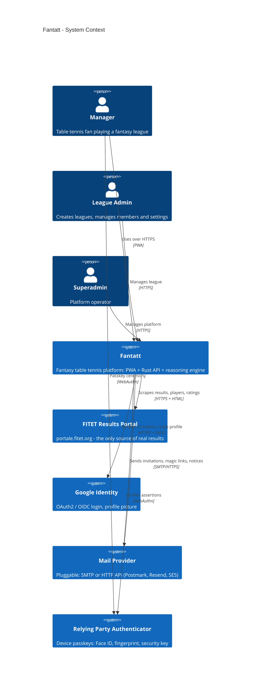
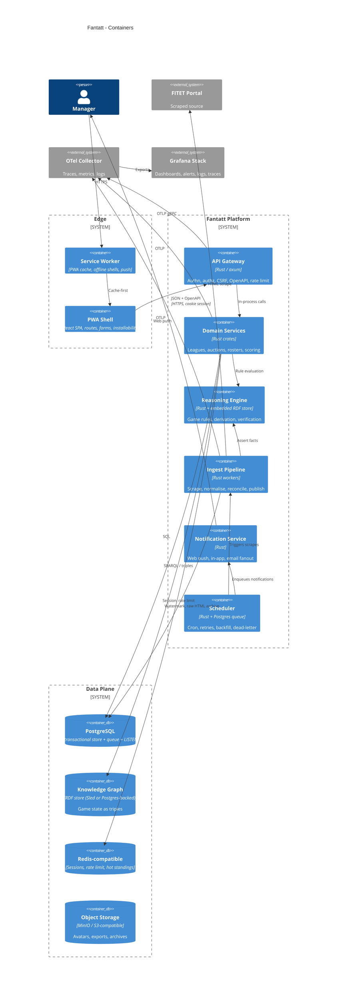
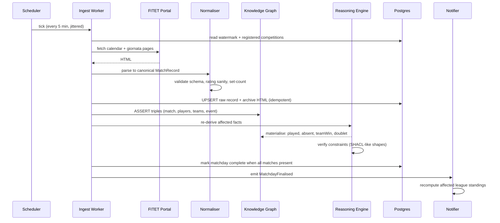
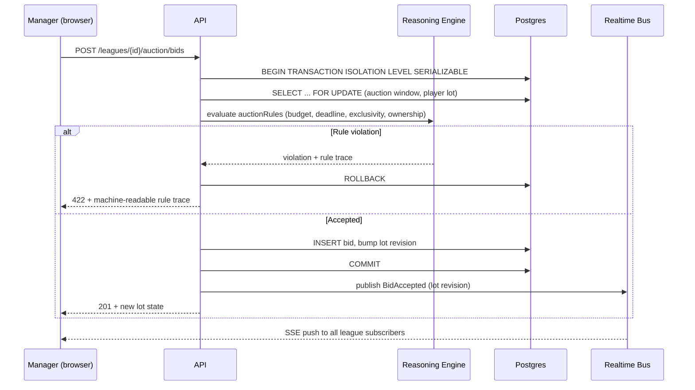
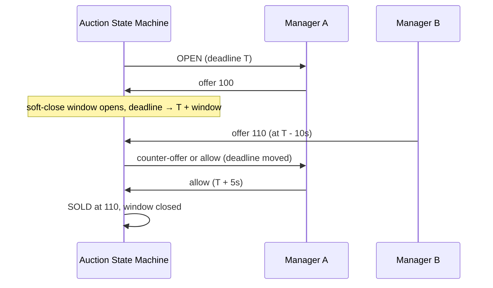
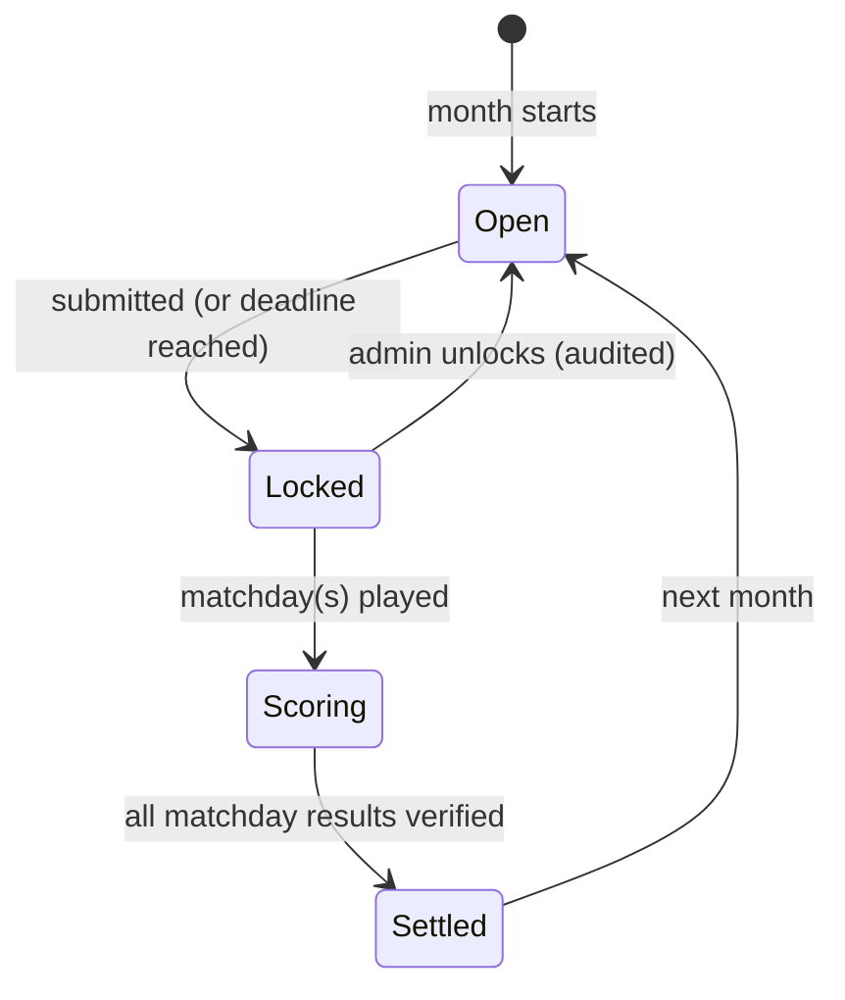
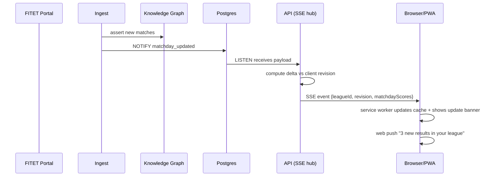
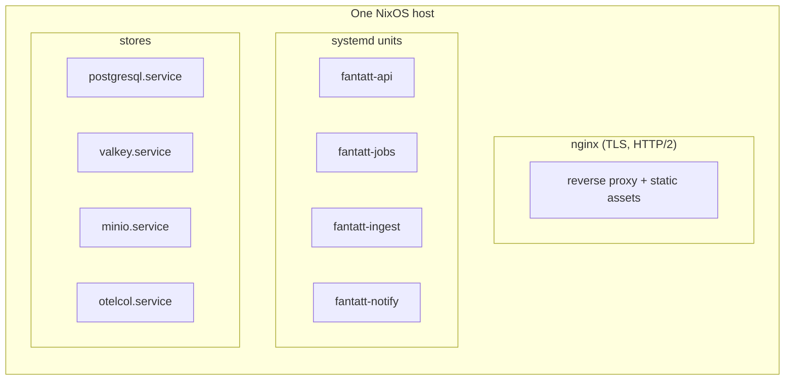
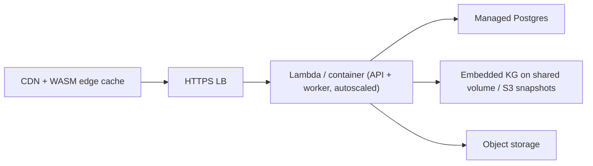

# System Architecture

## 1. C4 Context

## 2. C4 Container

## 3. Component decomposition

### 3.1 Workspace crates

| Crate | Responsibility | Depends on |
| --- | --- | --- |
| `fantatt-core` | Domain types, invariants, port traits. No I/O. | none |
| `fantatt-reasoning` | Rule engine, RDF store binding, verification queries | `fantatt-core` |
| `fantatt-scoring` | Pure scoring functions over derived facts | `fantatt-core` |
| `fantatt-ingest` | FITET scraper, HTML parser, normaliser, reconciler | `core` |
| `fantatt-api` | axum handlers, middleware, OpenAPI, DTOs | all of the above |
| `fantatt-jobs` | Scheduler, queue workers, backfill | `ingest`, `core` |
| `fantatt-notify` | Web push (VAPID), in-app, email facade | `core` |
| `fantatt-obs` | OTel wiring, metric definitions, log redaction | none |
| `fantatt-config` | Layered config load + validation + schema | none |

### 3.2 Data plane responsibilities

| Store | Why | Alternatives |
| --- | --- | --- |
| PostgreSQL | Transactions, serialisable isolation, advisory locks, `LISTEN/NOTIFY` — the backbone of correctness for auctions and a job queue. Battle-tested, cheap, no vendor. | None recommended for the transactional role. |
| Embedded RDF store | The knowledge graph itself: game state as triples, SPARQL for derivation, closed-world checks for validation. | Oxigraph (also Rust, SPARQL 1.1) — see ADR-002. |
| Redis / Valkey compatible | Sessions, rate limits, hot standings, pub/sub for live scores. One process, optional. | Dragonfly, KeyDB, in-process `moka` for single-node. |
| Object storage | Avatars, exports, raw response archive. | S3, MinIO, R2, filesystem. |

## 4. Key interactions

### 4.1 Ingest: real-world match to verified game state

**Idempotency:** every ingest step is keyed by `(source, source_id, content_hash)`.
Re-running a scrape with unchanged content asserts nothing new. This is what makes
"results as soon as possible" safe: we can scrape every 5 minutes.

### 4.2 Auction: strict high-concurrency correctness

Two-phase anti-overbidding:

### 4.3 Roster submission and lock

Roster submission is a **transactional validation**: the API calls the reasoning
engine with the whole candidate roster and the current competition facts; only a
`VALID` verdict commits. Violations return the exact rule and offending player,
so the UI can highlight the problem inline.

### 4.4 Live scores to the browser

## 5. Deployment topologies

### 5.1 Self-host (reference)

### 5.2 Cloud / serverless

The API binary is identical in both. Only the config file and the process
supervisor differ. See `14-deployment.md`.

## 6. Trust boundaries

| Boundary | Threat controlled |
| --- | --- |
| Browser ↔ API | XSS, CSRF, clickjacking, session theft |
| API ↔ Reasoning | Rule tampering; rules are versioned and content-addressed |
| Ingest ↔ FITET | HTML injection, malformed data, rate-limit bans, source drift |
| Workers ↔ DB | Job poisoning, unbounded retries |
| Admin ↔ platform | privilege escalation, unaudited state changes |
