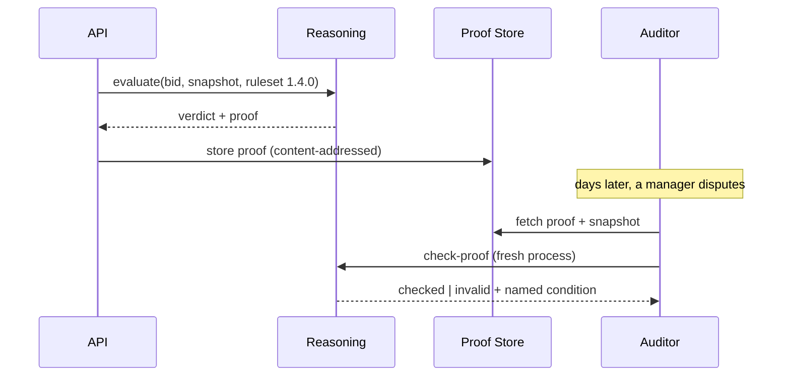

# Reasoning Rules: Game Logic as Verifiable Rules

Game logic is not hand-written `if` statements in a service. It is a **rule
bundle**: a content-addressed, versioned set of rules that the reasoning engine
evaluates against the knowledge graph. Every score, every rejected bid, every
locked roster is the product of a rule evaluation that can be re-run and
independently checked.

## 1. Principles

| Principle | Consequence |
| --- | --- |
| Rules are data, not code | A ruleset is a file, versioned, diffable, reviewable in a PR. |
| Rules are content-addressed | `rulesetVersion` = hash of the rule bundle. A score records which bundle produced it. |
| Evaluation is pure | Same graph + same rules = same result. No clock, no I/O, no randomness inside rules. |
| Every decision carries a trace | A rejection returns the offending rule and the facts it read. |
| Proofs are checkable | Critical decisions (auction close, roster accept, matchday settle) emit a proof a third party can verify offline. |
| Contract | Rules may only fail *validation*; they never silently repair data. |

## 2. Rule languages and toolchain (verified versions)

| Concern | Tool | Version | Role |
| --- | --- | --- | --- |
| RDF store | `oxigraph` | 0.5.13 (2026-10-22) | SPARQL 1.1 query/update, atomic writes |
| Shape validation | `rudof` | 0.1.12 (2024-08-13) | SHACL/ShEx validation of asserted facts (workspace dependency arrives with G1.9) |
| Closure | `reasonable` | 0.5.0-a1 / 0.4.4 | RDFS + OWL 2 RL materialisation |
| Rules + proofs | `eyeron` | 0.9.2 (2026-11-09) | N3 rules with **checkable proof certificates** |
| Rule language (authored) | N3 / SPARQL CONSTRUCT | — | Declarative, reviewable |

**Decision:** three rule engines, one store. Oxigraph holds the graph and answers
SPARQL; N3 rules in eyeron express game logic and emit proofs; SHACL shapes in
rudof guard data integrity on ingest. Rejected: `crepe` (rules fixed at compile
time — cannot be authored at runtime), `oxirs-rule` (pre-1.0, 3 breaking releases
in 7 months), TypeDB 3.x (replaced inference with explicit functions),
TerminusDB (no SPARQL, Prolog core, no Rust embedding), Jena/Fuseki (JVM),
CozoDB and differential-datalog (both dormant).

## 3. Rule bundle format

```
rules/<rulesetName>/<semver>/
  manifest.toml        # name, version, provenance, entry points
  ontology/*.ttl       # vocabulary + SHACL shapes
  rules/*.n3           # game logic
  queries/*.rq         # SPARQL derivations and reports
  tests/               # golden graph in, expected facts/proofs out
```

```toml
# manifest.toml
name = "fantatt-core"
version = "1.4.0"
entrypoints = ["roster.validate", "scoring.matchday", "auction.bid", "settle.standings"]
requires = ["tt-ontology@1.2.0"]
evidence = { source = "git", commit = "…", spec = "docs/05-scoring-spec.md §3" }
```

`rulesetVersion` is the SHA-256 of the concatenation of the manifest and every
rule file. Changing one constant creates a new ruleset and forces a recompute of
every score derived from the old one.

An entry point names its rule file and its golden case: `roster.validate` reads
`rules/roster.validate.n3` and is tested by `tests/golden/roster.validate/`
(`input.ttl`, `expected.ttl`, `expected.proof`). The loader refuses a bundle
whose manifest disagrees with its directory, whose entry point has no rule file
or no golden case, or that carries a file the layout does not declare.

The digest covers the manifest bytes followed by every file the bundle carries,
in sorted relative-path order, each contribution prefixed with its name length
and its byte length so no two different file sets can hash alike. `just rules`
loads every committed bundle and prints the version each one addresses.

## 4. Core rule set

### 4.1 Roster validity

```n3
@prefix tt: <https://fantatt.org/ontology/tt#> .
@prefix r:  <https://fantatt.org/rules/roster/1.4.0#> .
@prefix math: <http://www.w3.org/2000/10/swap/math#> .

# INV-2: squad size is fixed
r:squadSize a r:Rule ;
  r:when {
    ?squad a tt:Squad .
    { SELECT ?squad (COUNT(?slot) AS ?n) WHERE { ?squad tt:hasSlot ?slot } GROUP BY ?squad }
  } ;
  r:assert { ?squad r:squadSlotCount ?n } ;
  r:check  { ?n = 15 } ;
  r:violation r:E_RosterSize .

# INV-3: tier match between slot and player's active division
r:slotTierMatchesPlayer a r:Rule ;
  r:when {
    ?slot tt:slotPlayer ?player ; tt:slotTier ?tier .
    ?player tt:playsIn/tt:divisionTier ?tier .
  } ;
  r:assert { ?slot r:eligible true } ;
  r:check  { ?slot r:eligible true } ;
  r:violation r:E_IneligiblePlayer .

# INV-6: no duplicate player in a squad
r:noDuplicatePlayer a r:Rule ;
  r:when {
    { SELECT ?squad ?player (COUNT(?slot) AS ?n) WHERE {
        ?squad tt:hasSlot ?slot . ?slot tt:slotPlayer ?player .
      } GROUP BY ?squad ?player }
  } ;
  r:check  { ?n = 1 } ;
  r:violation r:E_DuplicatePlayer .

# INV-4: exclusivity in exclusive ownership mode
r:noSharedPlayerInExclusiveLeague a r:Rule ;
  r:when {
    ?league tt:ownershipMode tt:Exclusive .
    { SELECT ?league ?player (COUNT(?squad) AS ?n) WHERE {
        ?league tt:hasSquad ?squad . ?squad tt:hasSlot ?slot . ?slot tt:slotPlayer ?player .
      } GROUP BY ?league ?player }
  } ;
  r:check  { ?n <= 1 } ;
  r:violation r:E_SharedPlayerNotAllowed .
```

### 4.2 Starter and bench structure

```n3
# per tier: exactly 2 starters and 1 bench (INV-2 decomposition)
r:starterCountPerTier a r:Rule ;
  r:when {
    ?squad tt:hasSlot ?slot . ?slot tt:slotTier ?tier ; tt:slotKind tt:Starter .
    { SELECT ?squad ?tier (COUNT(?s) AS ?n) WHERE {
        ?squad tt:hasSlot ?s . ?s tt:slotTier ?tier ; tt:slotKind tt:Starter .
      } GROUP BY ?squad ?tier }
  } ;
  r:check  { ?n = 2 } ;
  r:violation r:E_StarterCount .
```

### 4.3 Substitution (INV-9 and the bench rule)

```n3
# a bench player replaces an absent starter only within its own tier
r:benchSubstitution a r:Rule ;
  r:when {
    ?squad tt:month ?month .
    ?slot a tt:SquadSlot ; tt:slotKind tt:Starter ; tt:slotTier ?tier ;
          tt:slotPlayer ?starter ; tt:inSquad ?squad .
    ?bench a tt:SquadSlot ; tt:slotKind tt:Bench ; tt:slotTier ?tier ;
           tt:slotPlayer ?benchPlayer ; tt:inSquad ?squad .
    ?md a tt:Matchday ; tt:month ?month .
    # starter did not appear in this matchday
    { SELECT ?md WHERE {
        ?md a tt:Matchday .
        FILTER NOT EXISTS { ?md tt:hasAppearance ?a . ?a tt:player ?starter ; tt:played true . }
      } }
  } ;
  r:assert { ?squad r:substitutedSlot ?bench ; r:reason r:AbsentStarter ; r:tier ?tier } ;
  r:check  { ?bench tt:slotTier ?tier } ;      # same tier, enforced by the join itself
  r:violation r:E_BenchTierMismatch .
```

The tier equality is a **structural** guarantee of the join, not a check that can
pass by luck. That is the point of encoding it as a rule: the impossible state is
unrepresentable rather than validated.

### 4.4 Gender-adjusted rating (3.2 A)

```n3
r:adjustedOpponentRating a r:Rule ;
  r:when {
    ?app tt:opponent ?opp .
    ?opp tt:gender tt:Female .
    ?player tt:gender tt:Male .
    ?opp tt:rating ?base .
  } ;
  r:assert { ?app tt:opponentRatingAdjusted (base * 0.75) } .

r:unadjustedOpponentRating a r:Rule ;
  r:when {
    ?app tt:opponent ?opp .
    { FILTER NOT EXISTS { ?player tt:gender tt:Male . ?opp tt:gender tt:Female . } }
    ?opp tt:rating ?base .
  } ;
  r:assert { ?app tt:opponentRatingAdjusted ?base } .
```

### 4.5 Rating multiplier (3.2)

```n3
r:ratingMultiplier a r:Rule ;
  r:when {
    ?app a tt:PlayerAppearance ; tt:appearanceKind tt:Singles ;
         tt:player ?player ; tt:opponentRatingAdjusted ?adj .
    ?player tt:rating ?own .
    ?adj - ?own = (diff) .
    ?diff / 400 = (ratio) .
  } ;
  r:assert { ?app tt:ratingRatio ?ratio ;
             r:multiplier (if(ratio > 1.0, ratio, 1.0)) } .

# doubles exempt from rating multiplier: r:assertMultiplier 1.0 (default, no rule needed)
```

The 0.75 gender adjustment applies to the **opponent** when the player is male and
the opponent female, per the spec's example (`4432 = 5970 * 0.75`). The reverse
case (female player vs male opponent) is not adjusted, per the spec text.

## 5. Auction rules (strict concurrency)

```n3
# INV-11: an offer wins only if it is the current highest and the window is open
r:bidValidity a r:Rule ;
  r:when {
    ?lot a tt:Lot ; tt:status tt:Open .
    ?bid a tt:Bid ; tt:lot ?lot ; tt:amount ?amount ;
         tt:placedAt ?at ; tt:manager ?m .
    { SELECT ?lot (MAX(?a) AS ?best) WHERE { ?b tt:lot ?lot ; tt:amount ?a } GROUP BY ?lot }
  } ;
  r:check  { ?amount = ?best } ;
  r:violation r:E_Outbid .

# INV-12: budget never exceeded
r:budgetCeiling a r:Rule ;
  r:when {
    ?m tt:inLeague ?league ; tt:budget ?b ; tt:committed ?c .
    ?bid tt:manager ?m ; tt:amount ?a .
  } ;
  r:check  { ?c + ?a <= ?b } ;
  r:violation r:E_BudgetExceeded .

# INV: exclusivity of the winner
r:exclusiveOwnershipBid a r:Rule ;
  r:when {
    ?league tt:ownershipMode tt:Exclusive .
    ?lot tt:inLeague ?league ; tt:player ?p .
    { SELECT ?league ?p (COUNT(?squad) AS ?n) WHERE {
        ?league tt:hasSquad ?squad . ?squad tt:hasSlot ?slot . ?slot tt:slotPlayer ?p .
      } GROUP BY ?league ?p }
  } ;
  r:check  { ?n = 0 } ;
  r:violation r:E_AlreadyOwned .
```

## 6. Proof certificates (auditability)

Critical decisions emit a proof that can be re-checked in a separate process,
which is what makes auction results defensible:

```
eyeron --check-proof rules/auction/1.4.0.n3 \
       --input data/league-7/bid-9931.n3 \
       --proof  out/bid-9931.proof
```

The certificate records every rule fired, the facts it read, and the resolution
step. To dispute a bid, an operator re-runs the check on the archived graph
snapshot; the verdict is `checked`, `checked with obligations`, or `invalid`.



## 7. Materialisation pipeline

Derived facts are written back into named graphs, one graph per derivation commit:

| Graph | Contents |
| --- | --- |
| `data:league/<id>/derived/<commitId>` | Slot eligibility, substitutions, scores |
| `data:matchday/<id>/derived/<commitId>` | Matchday completeness, team wins, doublets |
| `data:standings/<season>/<commitId>` | Month and season standings snapshots |

Rules are re-run head-to-head on snapshot isolation: a derivation commit reads one
snapshot and writes one graph. This makes recomputation deterministic and a rules
update a single traversal, not a migration.

## 8. Failure policy

| Failure | Behaviour |
| --- | --- |
| Roster invalid | 422 with rule traces: `[{rule, violation, players}]` |
| Bid invalid | 422 with rule trace; zero triples written |
| Ingest fact fails SHACL | Quarantined, reported to the admin; never silently accepted |
| Rule evaluation times out | Derivation aborts, previous graph remains authoritative, alert fires |
| Proof check fails | Decision reversed, incident opened, admin notified |

## 9. Rule test contract

For each rule: a **positive case**, a **negative case per violation**, and a
**boundary case**. Tests are golden-file: input graph, rule bundle, expected
derived graph, expected proof. This is the mechanism that guarantees the spec in
`05-scoring-spec.md` §8 stays true forever. A committed bundle carries one
golden case per entry point; the engine that evaluates them and emits the
certificates they expect arrives with the reasoning-engine goal.
