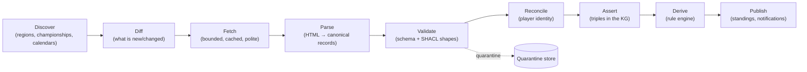

# Data Pipeline: FITET Ingest

## 1. Source

The FITET results portal (`https://portale.fitet.org/`) is the only source of
real results. It has no API: it is legacy PHP with framesets, query-string
identifiers, and hand-maintained HTML. The existing Python prototype
(`fitet/`) proved the scraping strategy; this document specifies its Rust
replacement.

## 2. Source surfaces (inherited from the prototype)

| Surface | URL pattern | Yields |
| --- | --- | --- |
| Home menus | `menu.php` | Championships, tournaments, rankings, regions |
| Region list | `risultati/regioni/menu_reg.php?REG=` | Region codes |
| Championship list | `risultati/regioni/menu_reg.php?REG=` + campionati table | Championship ids |
| Tournament types | `risultati/regioni/menu_tor.php?REG=` | Type codes |
| Tournament list | `risultati/tornei/elenco_tornei.php?TOR=&COMIT=&ID=0` | Tournament ids and names |
| Tabelloni | `risultati/tornei/tabelloni/{id}_{region}_home.html` | Bracket pages per section |
| Calendar | `risultati/campionati/Calendario.asp?CAM=&ANNO=` | Giornata links |
| Giornata | `risultati/campionati/giornata.php?CAM=&INCONTRO=&FORMULA=1` | Full matchday table |
| Classifica | `risultati/new_rank/...` + date pattern | Ranking snapshot id and date |
| Player search | `risultati/new_rank/ajax.php?term=...` (XHR) | Candidate player ids |
| Player detail | `risultati/new_rank/dettaglioatleta_unica.php?ATLETA=&ID_CLASS=&ZU=1&AVVERSARIO=0` | Player points |

Operational constraints learned from the prototype:

- **Concurrency must stay low.** More than ~20 concurrent requests take the site
  down. The Rust pipeline uses a bounded semaphore (default 4) plus per-host
  rate limiting and jitter.
- **Own pages are uploaded after play.** A tabellone page can 404 until the
  event is played; a giornata page exists before results are filled in. Missing
  data is normal and must not be an error.
- **The completeness marker** `(incontri disputati 63/72, completezza: 87.5%)`
  is the source of truth for whether a tabellone can be trusted. Partial
  brackets are skipped, not partially ingested.
- **Player identity is unstable.** Names repeat, ids differ per classifica.
  Ambiguity must be surfaced, never guessed.

## 3. Pipeline stages



### 3.1 Discover

Enumerates the source space: regions → championships → matchdays, and
regions → tournament types → tournaments → tabelloni. Output is a **work
manifest**: a deterministic list of fetch jobs with content keys. Discovery is
cheap and cached aggressively (one configurable TTL; the prototype used one
week, and the default is seven days).

The sweep (`fantatt-ingest::discover`) classifies every URL it meets by the
page it names and walks a fixed edge table over that classifier: the menu
points at the region framesets, the championship indexes, and the national
tournament types; a region frameset frames the regional championship menu and
the tournament menu; the championship list links the championship pages; and
each championship frames down to its calendar, its matchday homes, and their
referto and detail pages. Pages resolve and normalize before the walk stores
anything: lower-case scheme and host, no fragment, no default port, sorted
query pairs, dot segments removed. The normalized URL is the content key, so
two spellings of one target are one target.

Two cadences fall out of the walk. The cheap topology — the menu, the
framesets, the menus, the indexes and lists — is re-read on every sweep,
because its links are the only map the walk has. The expansion levels below a
championship are cached: a page whose content hash matches the ledger is not
re-expanded, so an unchanged portal yields an empty work list and a new or
changed championship expands down to its leaves. The leaves — giornata
pages, match details, tournament result pages — are the fetch jobs; discovery
itself fetches only the pages it walks, and a walk archives its page behind
the client. A leaf the ledger already holds fresh plans no job, because the
worker re-checks it at its own cadence with the stored validators. A
commented-out link is not a fetch target, and a page the source cannot
deliver prunes its branch instead of failing the sweep. The plan sorts by
surface then URL, so it is deterministic whatever order the walk reached
pages in.

### 3.2 Diff

Each job compares the target against the ingest ledger:

| Case | Action |
| --- | --- |
| Not seen, page exists | Fetch |
| Seen, `etag`/`content-hash` unchanged | Skip |
| Seen, changed | Fetch, then event-sourced update |
| Seen, marked incomplete | Skip until complete |

Diffing by content hash is what allows scraping every few minutes safely.

The ledger keeps one row per (source, url, content hash): a new hash appends
history while a known hash refreshes its `fetched_at`, so the cache window
never expires for a page that keeps answering 304, and the diff reads the
newest row per URL. The queue dedupes by the partial unique index on the
active states, so a sweep that re-plans an unchanged page inserts nothing,
and a finished job frees its key.

### 3.3 Fetch

- `reqwest` with `rustls`, HTTP/2, connection pooling.
- Global semaphore (default 4) + per-host token bucket.
- Retries with exponential backoff and jitter; circuit breaker after
  consecutive failures.
- Conditional requests (`If-None-Match`) where the source supports them.
- Raw responses archived to object storage (configurable, can be disabled) so
  any past result can be re-parsed without re-scraping.
- **Edge behavior**: the portal's HTTPS edge resets non-browser TLS clients with
  a connection reset before any HTTP exchange — the rustls client the facade
  uses among them, while the plain-HTTP origin answers normally and a browser
  does not help because the reset precedes HTTP. `just fixtures-capture`
  therefore records through curl, and `just discover-smoke` walks over
  `http://` through `FANTATT_SMOKE_BASE_URL`. The facade itself retries a
  refused transport, opens the circuit, and reports the block, so an
  edge-blocked source degrades exactly as G1.2 specifies.

### 3.4 Parse

Pure functions from owned page bytes to canonical records. No I/O, no network,
fully unit-testable with recorded fixtures. The giornata parser
(`fantatt-ingest::giornata`) is the first stage; the calendar, classification,
player, and bracket surfaces land with G1.5 and G1.11.

Canonical record:

```rust
struct RawGiornata {
    championship_id: String,   // the CAM query value
    contest_id: String,        // the INCONTRO query value
    date: Option<Date>,        // none when the referto confirms no date yet
    home_team: String,
    away_team: String,
    venue: Option<String>,     // the campo gara block, label stripped
    rows: Vec<GiornataRow>,
}

struct GiornataRow {
    match_number: u32,
    detail_id: Option<String>, // the ID of the tie's detail page
    player_a: String,          // canonical form; a doubles pair is one cell
    player_b: String,
    sets: Vec<(u8, u8)>,       // three to five, in play order
}
```

A parse returns the record plus a skip log: every tie the page carried but the
matchday cannot count, each with a reason (`not_a_tie` for a row that is prose,
`unplayed` for a tie whose every set pair is empty), so a scheduled matchday
without ties and a tie without a result are observable states rather than
errors. A page reporting the `(incontri disputati …)` marker fails the parse
with its counts instead of yielding partial data.

Parsing rules:

- Names are title-cased per word, including after an apostrophe, and inner
  whitespace collapses (`"FACENDA SAMUELE"` → `"Facenda Samuele"`,
  `"D'ANGELO MARIO"` → `"D'Angelo Mario"`). The shared normalization is the
  same function identity reconciliation (G1.6) resolves against.
- `assente`/`ritirato` results become a 0-3 or 3-0 walkover, direction from the
  marker text: a marker on the home player, on one of the home set cells, or on
  the sets-won summary records three sets to love for the away side, and
  symmetrically for the away side.
- A row whose first cell is not a digit is not a tie.
- Unplayed ties are skipped with a reason.
- Team names and venue text keep the portal's spelling, trimmed and with inner
  whitespace collapsed.
- Every failure is a typed error naming the selector, row, or cell at fault:
  the societies (`p.incontro`), the giornata heading (`b`, which a paragraph
  cannot contain because it closes before its own `center`), the tie table
  header (`p.titolo_scheda`), or the row and cell of malformed text. The
  declared set counts in the summary cells are cross-checked against the scores
  as a drift signal.
- Tournament brackets use the elimination-table layout with `bit_count` logic
  for byes, third-place matches, and consolation brackets.
- Set scores in brackets may carry `(R)` for retired, encoded as 0.

### 3.5 Validate

Two layers:

1. **Structural:** JSON Schema on the parsed record (set counts 3–5, points in
   range, both players present, date parseable).
2. **Semantic (SHACL):** shapes from the ruleset. A player with a rating change
   of > 500 points in one import is quarantined for review. A matchday with more
   ties than the format allows is quarantined.

Quarantine is a first-class state with an admin queue and a resolution action.
Nothing is silently dropped.

### 3.6 Reconcile

Player identity resolution:

```
alias → candidates (classifica entries)
      → filter by region/competition evidence
      → RESOLVED | AMBIGUOUS | UNRESOLVED
```

- `RESOLVED`: exactly one candidate within tolerance → link and inherit rating.
- `AMBIGUOUS`: several candidates → admin resolves; the player is playable but
  flagged; scores use the provisional rating until resolved.
- `UNRESOLVED`: no candidate → provisional player, rating 2000 (the prototype's
  `NEW_PLAYER_SCORE`), visible in the UI as "new/unranked".

Ratings are stored per `asOf` date, never overwritten in place, so historical
scoring is reproducible.

### 3.7 Assert and derive

Triples go into the knowledge graph with provenance. Then the rule engine
materialises: appearances → matchday facts → player scores → squad scores →
standings. Each derivation is a named-graph commit (see `04-reasoning-rules.md`).

### 3.8 Publish

- `MATCHDAY_FINALISED` event → recompute affected leagues → push via SSE.
- Notifications: web push, in-app, email (facade).
- Admin digest: new players, unresolved identities, quarantined records.

## 4. Scheduling

| Job | Cadence | Notes |
| --- | --- | --- |
| Discovery sweep | 30 min | Cheap, cacheable |
| Matchday fetch | 5 min, jittered | Only for registered competitions with pending matchdays |
| Tabellone fetch | 10 min | Only for tournaments in progress |
| Classifica import | Daily | Ratings change slowly |
| Player reconcile | On demand + daily | Review queue |
| Full backfill | Manual | Admin-triggered, rate-limited |

`tokio-cron-scheduler` (0.15.1) drives cadence. Job state lives in Postgres so a
restart does not lose schedule; the queue is the same Postgres `LISTEN/NOTIFY`
mechanism used elsewhere. The sweep interval comes from
`ingest.discovery_interval_minutes` (30 minutes by default), the politeness
bounds from the same section, and a finished sweep notifies a listening worker
on the `fantatt_jobs` channel.

## 5. Failure and fairness

| Failure | Behaviour |
| --- | --- |
| Source 404 on a known matchday | Retry with backoff, then alert. Never treated as "no results". |
| HTML structure change | Parser returns a typed error; the affected selector is reported. |
| Rate limit / block | Circuit breaker, exponential cool-down, admin alert. |
| Partial matchday | Held in `PARTIAL` state; not aggregated until complete or expressly closed. |
| Duplicate fetch | Idempotent by content hash. |
| Late-arriving result | Event-sourced update re-derives the matchday and emits a correction notice. |

## 6. Mode coverage

| Mode | Source path |
| --- | --- |
| Weekend Championship | Calendar → giornata pages |
| Tournaments (predictor) | Tournament list → tabelloni (gironi + eliminatorie) |
| Open / Top / Italian Championships | Tabellone sections; `Top AB` requires a bespoke parser (prototype TODO) |

The predictor mode does not need live scraping during play: it consumes the
final bracket structure before the event, then the results for scoring.

## 7. Local development fixtures

The prototype's `assets/matches.json` (1085 matches, both `partita` and `torneo`
sources) is promoted to a golden fixture set: recorded HTML plus the expected
canonical records. Tests replay them without network access.

Twelve referti are recorded: the corpus side pins the expected records (every
one of the 1085 matches is a canonical tie, the eighteen walkovers included),
and the HTML side is the parser's input — twelve matchdays across three
championships, including a doubles tie, a scheduled matchday with a future
date, and one whose date is not confirmed yet. The parser test compares every
page byte for byte with the canonical record committed under
`crates/fantatt-ingest/tests/golden/`, so a parser change or a portal drift
fails the suite; a mutated page fails naming the selector that broke.
