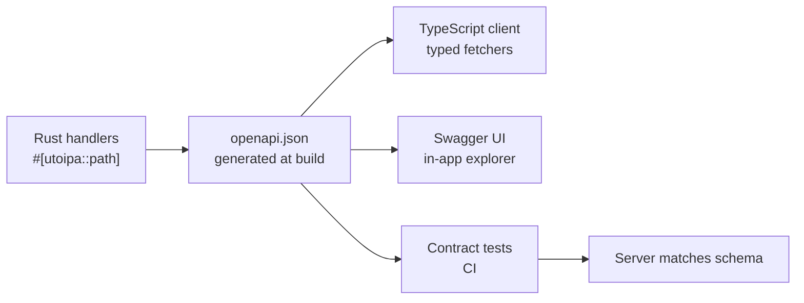

# API Specification

The API is the contract between the PWA, the administration surface, and any
third-party integration. It is generated from Rust handler annotations with
`utoipa` 6.0.0 (OpenAPI 3.1) and served as both a machine-readable schema and an
interactive explorer. TypeScript clients are generated from that schema.

## 1. Base conventions

| Item | Value |
| --- | --- |
| Base path | `/api/v1` |
| Encoding | `application/json; charset=utf-8` |
| Auth | Cookie session (passkey or OAuth) + `X-CSRF-Token` header |
| Time | RFC 3339 UTC (`2026-11-10T20:41:03Z`) |
| Dates | ISO 8601 calendar dates |
| Identifiers | Prefixed ULIDs: `lg_`, `usr_`, `plr_`, `cmp_`, `md_`, `sq_` |
| Money | ISO 4217 code + integer minor units, or league-relative credits as integers |
| Pagination | `?limit=&cursor=` with an opaque cursor; `Link` header |
| Errors | RFC 9457 `application/problem+json` |
| Idempotency | `Idempotency-Key` header on all `POST` that create |
| Versioning | Path version, additive-only changes within a version |
| Compression | `br`/`gzip` responses |

## 2. Authentication and session

| Endpoint | Method | Purpose |
| --- | --- | --- |
| `/auth/oauth/google/start` | POST | Begin Google OAuth2, return redirect URL + state |
| `/auth/oauth/google/callback` | GET | Exchange code, establish session |
| `/auth/passkeys/register/start` | POST | Begin passkey registration (authenticated) |
| `/auth/passkeys/register/finish` | POST | Complete registration |
| `/auth/passkeys/login/start` | POST | Begin assertion (email or discoverable) |
| `/auth/passkeys/login/finish` | POST | Verify assertion, establish session |
| `/auth/session` | GET | Current user and capabilities |
| `/auth/session` | DELETE | Log out, revoke session and CSRF token |
| `/auth/csrf` | GET | Issue CSRF token bound to the session |

Session policy:

- Cookie: `__Host-session`, `HttpOnly`, `Secure`, `SameSite=Lax`, `Path=/`.
- Session lifetime: 30 days idle, 12 hours absolute; rotating on privilege change.
- Passkey login is always available; Google login provides name, email, and
  profile picture, which the user may edit.

## 3. Account and profile

| Endpoint | Method | Notes |
| --- | --- | --- |
| `/me` | GET | Profile, roles, memberships |
| `/me` | PATCH | Update display name, description, locale |
| `/me/avatar` | PUT | Upload image (validated, resized, stored via storage facade) |
| `/me/avatar` | DELETE | Reset to generated default |
| `/me/credentials/passkeys` | GET | List registered authenticators |
| `/me/credentials/passkeys/{id}` | DELETE | Revoke an authenticator |
| `/me/export` | POST | Request GDPR data export, delivered async |
| `/me/deletion` | POST | Schedule deletion, 30-day grace |
| `/me/deletion` | DELETE | Cancel a scheduled deletion |
| `/me/privacy-consents` | GET / PUT | Recorded consents with version and timestamp |

## 4. Discovery: competitions and players

| Endpoint | Method | Notes |
| --- | --- | --- |
| `/competitions` | GET | Filter by region, tier, season, gender, kind |
| `/competitions/{id}` | GET | Detail, matchdays, draw-from hint |
| `/competitions/{id}/matchdays` | GET | List with status |
| `/matchdays/{id}` | GET | Ties, appearances, derived points |
| `/players` | GET | Search by name, filter by tier, region, availability |
| `/players/{id}` | GET | Profile, rating, form, cost, recent appearances |
| `/players/{id}/appearances` | GET | Paginated real results with full scoring breakdown |

Every player appearance response exposes the **full breakdown**: base points,
each multiplier applied, bonuses, and the rule version, so a manager can audit
their own score.

## 5. Leagues

| Endpoint | Method | Notes |
| --- | --- | --- |
| `/leagues` | GET | Leagues visible to the caller |
| `/leagues` | POST | Create (organizer only) |
| `/leagues/{id}` | GET / PATCH / DELETE | Read, update settings, archive |
| `/leagues/{id}/settings` | PUT | Runtime config: budget, locks, ruleset, resell day |
| `/leagues/{id}/members` | GET | Members and roles |
| `/leagues/{id}/invitations` | POST | Generate an invite link or email |
| `/leagues/{id}/invitations/{token}/accept` | POST | Join by link |
| `/leagues/{id}/join-requests` | GET / POST | Request-to-join flow |
| `/leagues/{id}/join-requests/{id}` | POST | Approve or reject (organizer) |
| `/leagues/{id}/audit-log` | GET | Append-only, tamper-evident |
| `/leagues/{id}/recompute` | POST | Re-derive from a ruleset (superadmin) |

League creation body:

```json
{
  "name": "Trentino Masters",
  "seasonYear": 2027,
  "ownershipMode": "exclusive",
  "startingBudget": { "amount": 1000, "unit": "credits" },
  "competitions": ["cmp_c2_trentino_a", "cmp_d1_trentino"],
  "settings": {
    "resellDayOfMonth": 7,
    "rosterLockMode": "submit-or-deadline",
    "lockDeadlineHour": 20,
    "allowWeekOne": false,
    "benchSubstitution": "automatic"
  }
}
```

## 6. Squads (rosters)

| Endpoint | Method | Notes |
| --- | --- | --- |
| `/leagues/{id}/squads/me` | GET | Current squad for the open month |
| `/leagues/{id}/squads/me` | PATCH | Modify draft slots |
| `/leagues/{id}/squads/me/submissions` | POST | Submit for the month |
| `/leagues/{id}/squads/me/submissions/{month}/unlock` | POST | Admin unlock only |
| `/leagues/{id}/squads` | GET | All squads (organizer) |
| `/leagues/{id}/squads/{squadId}` | GET | Detailed roster with cost and projections |

Submit response carries the normalized squad with computed prices and the
projected matchday ceiling. Validation failures return rule traces:

```json
{
  "type": "https://fantatt.org/problems/roster-invalid",
  "title": "Roster rejected by game rules",
  "status": 422,
  "code": "E_IneligiblePlayer",
  "rule": "https://fantatt.org/rules/roster/1.4.0#slotTierMatchesPlayer",
  "details": [{ "slot": "d1-2", "player": "plr_9f2", "playerTier": "C1" }]
}
```

Each error identifies the ruleset, the rule, and the offending players.

## 7. Auction (exclusive mode)

| Endpoint | Method | Notes |
| --- | --- | --- |
| `/leagues/{id}/auction` | GET | State, lots, timers |
| `/leagues/{id}/auction/lots` | GET | Open and closed lots |
| `/leagues/{id}/auction/lots/{lotId}` | GET | Lot with offer history |
| `/leagues/{id}/auction/lots/{lotId}/bids` | POST | Place or raise a bid (serialized) |
| `/leagues/{id}/auction/lots/{lotId}/counter-offers` | POST | Owner counter-offers |
| `/leagues/{id}/auction/lots/{lotId}/accept` | POST | Accept the current best |
| `/leagues/{id}/auction/resell` | POST | Monthly resell phase, manager-to-manager sales |
| `/leagues/{id}/auction/events` | GET | Event log (open/close/(populated)) |

Bid response:

```json
{
  "lotId": "lot_3f1",
  "playerId": "plr_8f2a",
  "amount": 110,
  "deadline": "2026-11-14T22:00:00Z",
  "softCloseSeconds": 60,
  "revision": "evt_1kd2",
  "outbidManagerIds": ["usr_11a"]
}
```

## 8. Scoring and standings

| Endpoint | Method | Notes |
| --- | --- | --- |
| `/leagues/{id}/standings` | GET | Month and season, with deltas |
| `/leagues/{id}/matchdays` | GET | League matchday calendar |
| `/leagues/{id}/matchdays/{matchdayId}/scores` | GET | Full per-player breakdown |
| `/leagues/{id}/scoring-rules` | GET | The active rule bundle in effect |
| `/scoring-rules/{version}` | GET | Immutable historical bundle |

Standings entries include the score, the contributing players, and the
substitution decisions taken.

## 9. Tournaments (predictor mode)

| Endpoint | Method | Notes |
| --- | --- | --- |
| `/tournaments` | GET | Open, Top, Italian Championships |
| `/tournaments/{id}` | GET | Bracket structure, deadline |
| `/tournaments/{id}/predictions` | PUT | Submit bracket picks |
| `/tournaments/{id}/predictions` | GET | Current picks and live points |

## 10. Notifications

| Endpoint | Method | Notes |
| --- | --- | --- |
| `/notifications` | GET | In-app inbox |
| `/notifications/{id}/read` | POST | Mark read |
| `/notifications/preferences` | PUT | Channels, quiet hours, league filters |
| `/notifications/push/subscribe` | POST | Store a Web Push subscription (VAPID) |
| `/notifications/push/vapid-public-key` | GET | Client key for `pushManager.subscribe` |

## 11. Real-time

| Endpoint | Notes |
| --- | --- |
| `GET /api/v1/stream` | SSE hub: matchday updates, auction events, notification counts. Channels selected by `?league=` subscription cookie; each event carries a monotonic revision for client reconciliation. |

Event envelope:

```json
{
  "type": "matchday.updated",
  "revision": "a19f...",
  "occurredAt": "2026-11-08T20:47:00Z",
  "leagueId": "lg_2kd",
  "data": { "matchdayId": "md_991", "changedPlayers": ["plr_8f2a"] }
}
```

## 12. Admin

| Endpoint | Method | Notes |
| --- | --- | --- |
| `/admin/players/reconciliation` | GET | Ambiguous identity queue |
| `/admin/players/reconciliation/{id}` | POST | Resolve a merge |
| `/admin/ingest/jobs` | GET | Pipeline state, next run, last error |
| `/admin/ingest/jobs/{id}/run` | POST | Force a run |
| `/admin/ingest/quarantine` | GET | Quarantined records |
| `/admin/ingest/quarantine/{id}` | POST | Accept, correct, or discard |
| `/admin/leagues` | GET | All leagues, filter by state |
| `/admin/users` | GET | Users, roles, deletion windows |
| `/admin/users/{id}/roles` | PUT | Assign superadmin |
| `/admin/rulesets` | GET / POST | Published rule bundles |
| `/admin/config` | GET / PUT | Runtime configuration |
| `/admin/telemetry/status` | GET | OTel pipeline health |

## 13. Roles and capabilities

`fantatt-core` defines these roles, enforced server-side in the API:

| Role | Scope | Capabilities |
| --- | --- | --- |
| `superadmin` | Platform | Everything, including ruleset publication and user role assignment |
| `league_admin` | League | Manage league settings, members, join requests, squad unlocks, resell windows |
| `collaborator` | League | Manage rosters and invites; cannot change ownership mode or delete the league |
| `manager` | League | Manage own squad and bids |
| `member` | Account only | Own profile, credentials, consents |

Superadmin is an explicit grant list held in configuration; nothing is implied
by account creation.

## 14. Rate limits

| Path | Limit |
| --- | --- |
| `/auth/*` | 10/min per IP, 5/min per account |
| `/players?search=` | 60/min |
| Auction bids | 20/min per manager |
| General reads | 300/min per session |

## 15. OpenAPI toolchain



The schema is generated at build time and checked into CI: a handler that
changes response shape without a version bump fails the build.
