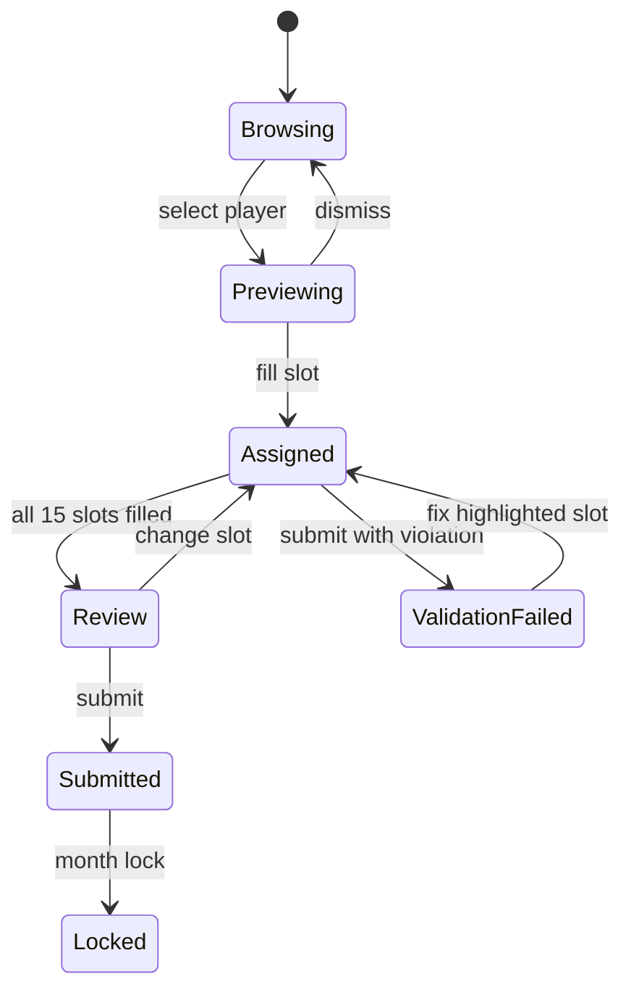
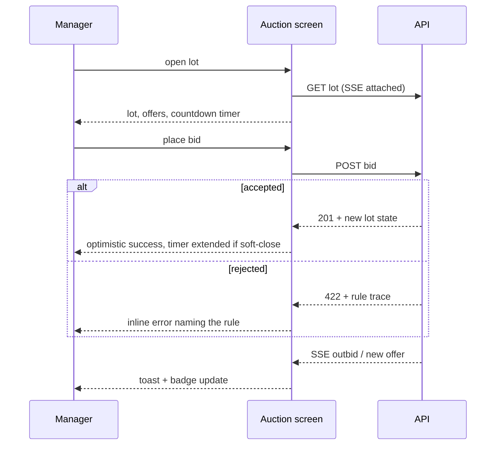

# Frontend: Mobile-First PWA

## 1. Stack

| Layer | Choice | Version |
| --- | --- | --- |
| Framework | React 19 + TypeScript | react 19.3.1 |
| Build | Vite (Rolldown) | 8.0 |
| Styling | Tailwind CSS v4 (CSS-first `@theme`, OKLCH, container queries) | 4.3.5 |
| Components | shadcn/ui over Radix primitives | cli v4 |
| Motion | View Transitions API (same-document), `@starting-style`, Open Props | — |
| PWA | `vite-plugin-pwa` (Workbox) | 2.0.0 |
| Realtime | `EventSource` against `/api/v1/stream` | — |
| Tests | Vitest + Testing Library, Playwright | 1.65.0 |

React is chosen for hiring depth and ecosystem parity; SvelteKit 3 is the
accepted alternative if payload size becomes the dominant concern. The design
system below is framework-neutral.

## 2. Design language

The visual identity is original and documented in `09-brandbook.md`.

| Principle | Implementation |
| --- | --- |
| Mobile first | Every layout starts from 360 px width |
| Touch first | Minimum 44×44 px targets; actions in the thumb zone |
| Performance budget | < 150 KB gzipped initial JS, < 1.5 s LCP on 4G |
| Honest states | Every async action has explicit loading, error, and success states |
| No dead ends | Every screen has a next action |
| Motion with meaning | Transitions 120–240 ms, only for state change, never decoration |
| Reduced motion | `prefers-reduced-motion` respected everywhere |

## 3. Information architecture

```
/                      Home: live matchday card, next deadline, standing delta
/players               Search, filters, cost, form
/players/:id           Player detail with full scoring breakdown
/leagues               My leagues, invitations
/leagues/:id           League home: standings, next matchday, resell status
/leagues/:id/squad     Roster builder (15 slots over 5 tiers)
/leagues/:id/auction   Auction: lots, bids, timers
/leagues/:id/standings Month and season standings
/leagues/:id/settings  League admin panel
/tournaments           Predictor events
/tournaments/:id       Bracket predictions
/profile               Profile, description, avatar, credentials
/admin                 Superadmin and league admin consoles
/settings              Preferences, notifications, privacy, delete account
```

Every route is deep-linkable and shareable. A shared link restores the exact
view: `/leagues/lg_2kd/squad?month=2027-01&highlight=slot_d1_2`.

## 4. Core flows

### 4.1 Roster builder



Requirements:

- The 15 slots are shown as a tier grid: each tier a column with 2 starters and
  1 bench. On mobile the grid scrolls horizontally with a sticky tier header.
- A player is addable only in their tier; attempts show an inline explanation
  naming the rule (`E_IneligiblePlayer`) rather than a disabled button.
- Live validation: budget, exclusivity, duplicates, and substitution viability
  are checked client-side against a mirrored ruleset, then authoritatively by the
  server. The mirror is generated from the same rule bundle, so it cannot drift.
- Cost per slot and total are visible at all times, with a projection of the
  weekly ceiling.
- Unsaved changes survive navigation (draft in `localStorage`, scoped to league
  and month).

### 4.2 Auction



Requirements:

- Single timer, never a local-only countdown: the client trusts server time
  (adjusts by `Date` header offset), and disables the bid button in the last
  500 ms.
- Outbid alerts are push + in-app, never only visual.
- Every bid shows its own state (winning, outbid, counter-offer, accepted).

### 4.3 Matchday live

- A live card lists today's players: played / not yet / absent.
- Substitutions appear the moment an absence is confirmed, with the reason.
- Score updates stream in; a delta badge shows the change against the previous
  revision.
- Offline: last known state is served from the service worker cache.

### 4.4 Accessibility and i18n

- WCAG 2.2 AA: focus visible, logical order, 4.5:1 text contrast, live regions
  for score changes.
- All copy goes through the i18n layer (`fluent` on the server, ICU messages on
  the client); no hardcoded strings in components.
- Locale: `it` default, `en` supported.

## 5. State management

| Kind | Tool |
| --- | --- |
| Server state | TanStack Query (cache, revalidation, SSE invalidation) |
| URL state | Search params as the source of truth for filters and views |
| Session/auth | A small context, no global store |
| Drafts | `localStorage` with a schema version and expiry |

No Redux. Server data belongs to the server; the URL holds the view.

## 6. PWA behaviour

### 6.1 Installability

- Web manifest: `display: standalone`, `start_url`, `theme_color`,
  `background_color`, maskable icons at 192/512.
- Custom install prompt via `beforeinstallprompt`.
- iOS 16.4+ show the "Add to Home Screen" prompt; push is supported there.

### 6.2 Caching

| Route | Strategy |
| --- | --- |
| App shell, hashed assets | CacheFirst, content-hashed revisions |
| Navigations | StaleWhileRevalidate with a network fallback |
| Live scores | NetworkFirst, cache as offline fallback |
| Images | CacheFirst with a size cap and LRU eviction |

### 6.3 Update flow

```js
navigator.serviceWorker.register('/sw.js', { updateViaCache: 'none' })
  .then((reg) => {
    reg.addEventListener('updatefound', () => {
      const sw = reg.installing;
      sw?.addEventListener('statechange', () => {
        if (sw.state === 'installed' && navigator.serviceWorker.controller) {
          showUpdateToast();
        }
      });
    });
    setInterval(() => reg.update(), 30 * 60 * 1000);
  });
```

The service worker calls `self.skipWaiting()` on install and
`e.waitUntil(self.clients.claim())` on activate, so the reload takes effect
immediately once the user accepts. The user is always asked; updates never
interrupt an in-progress roster edit.

### 6.4 Push

- VAPID keys per environment; the public key comes from
  `GET /notifications/push/vapid-public-key`.
- Categories are individually subscribable: results, auction, league
  announcements, admin alerts.
- Clicking a notification opens the exact deep link.

## 7. Error and confirmation patterns

| Situation | Pattern |
| --- | --- |
| Field error | Inline, next to the field, naming the rule |
| Action rejected | Toast with the reason and a retry action |
| Destructive action | Confirmation dialog with the consequences stated |
| Concurrency conflict | Banner showing the new state and a reload action |
| Offline | Persistent offline banner; writes queued and replayed on reconnect |
| Long operation | Progress with an exact countdown to the deadline |

## 8. Frontend testing

| Level | Tool | Scope |
| --- | --- | --- |
| Unit | Vitest | Pure functions, formatters, ruleset mirror |
| Component | Testing Library | Interaction states, keyboard navigation, focus order |
| Accessibility | axe-core | Every route |
| Visual | Playwright screenshots | Key screens, per viewport |
| E2E | Playwright | Flows below |

E2E flows (see `15-testing.md` for full detail): first visit and install,
Google login, roster build and submit, auction bid and outbid, live matchday,
invite and join, profile edit, GDPR export.
