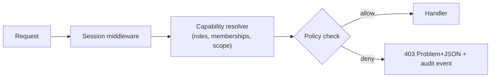

# Security Model

Security requirements are non-negotiable. This document defines the controls,
their implementation points, and how they are verified.

## 1. Authentication

### 1.1 Passwords

There are none. The system never stores, transmits, or resets a password. Email
addresses are used for account identity and notifications, never as a
credential. This removes the entire credential-stuffing and password-reset
attack surface.

### 1.2 Passkeys (primary)

- WebAuthn, server-side via `webauthn-rs` 0.6.2.
- `PublicKeyCredentialCreationOptions` with `requireUserVerification: true`,
  resident keys preferred, `authenticatorAttachment` unrestricted.
- At least one passkey is required before a Google-only account may act as a
  league admin (defence against account takeover via the OAuth identity alone).
- Multiple authenticators per account; each named by the user.
- Challenge storage in the session (never in a client-readable store), single
  use, short-lived (≤ 5 min).
- Origin and RP-ID validated on both registration and assertion.
- Counter verification with clone detection triggers a security event.

### 1.3 Google OAuth (convenience)

- Authorization Code flow with PKCE (`oauth2` 5.0.0 / `openidconnect` 4.1.0).
- Scopes: `openid email profile`.
- Requested claims: `name`, `email`, `picture` (used as the default avatar).
- ID token signature and `iss`/`aud`/`exp`/`nonce` verified server-side.
- `email_verified` required before linking to an existing account.
- Account linking only against a verified email; a different verified email
  never silently replaces the primary.
- The Google profile is the *seed* of the profile; the user can edit name,
  description, and avatar at any time.

### 1.4 Sessions

| Property | Value |
| --- | --- |
| Cookie | `__Host-session` |
| Flags | `HttpOnly`, `Secure`, `SameSite=Lax`, `Path=/` |
| Storage | Server-side (Postgres via `tower-sessions-sqlx-store`), cookie holds an opaque 256-bit id |
| Idle timeout | 30 days, sliding |
| Absolute timeout | 12 hours |
| Rotation | On login, on role change, on passkey add/remove |
| Revocation | On logout, on deletion, on security event |

`__Host-` prefix requires `Secure` and `Path=/`, which structurally prevents
domain-cookie attacks. No token is ever stored in `localStorage`, so XSS cannot
exfiltrate a session.

## 2. CSRF

All mutating requests require a synchronizer token:

- `GET /auth/csrf` returns a token bound to the session (`axum_csrf` 0.12.0,
  HMAC over the session id with a server secret).
- The client sends it as `X-CSRF-Token` on every `POST`, `PATCH`, `PUT`,
  `DELETE`.
- The server rejects mismatched or missing tokens with 403.
- `SameSite=Lax` is the second layer; the header check is the enforced one.
- CORS is not enabled for browser origins at all: the API is same-origin behind
  the proxy, which eliminates cross-origin writes by construction.

## 3. XSS and content injection

| Control | Detail |
| --- | --- |
| CSP | `default-src 'none'; script-src 'nonce-<random>'; style-src 'nonce-<random>'; img-src 'self' data: blob:; connect-src 'self'; font-src 'self'; frame-ancestors 'none'; base-uri 'none'; form-action 'none'; object-src 'none'; require-trusted-types-for 'script'` |
| Nonces | Per-response, CSP level 2/3 compatible, generated by the API proxy template |
| React | No `dangerouslySetInnerHTML` anywhere; all user text rendered as text nodes |
| Trusted Types | Enforced, with a policy for the few required sinks |
| External data | All scraped and user strings are escaped by construction; no HTML is stored |
| `frame-ancestors 'none'` | Clickjacking impossible |
| `base-uri 'none'` | Base-tag injection impossible |
| Uploads | Avatars are re-encoded (dimensions, format, metadata stripped) and served from a separate origin with `Content-Type: image/*` and a CSP-restricted host |

## 4. Authorisation

Enforced at the API layer on **every** request. The UI never gates access.

| Principle | Implementation |
| --- | --- |
| Default deny | Every route declares its required capability; unmatched → 403 |
| No IDOR | Object-level checks on every id: `league:read` is scoped by membership |
| Role source of truth | Database, never the client |
| Privilege escalation | Only `superadmin` may grant `league_admin`; the list is config |
| Admin actions | Audited with actor, before/after, and reason |

The implemented model — the capability table, the route declaration format,
the authorize middleware, and the seeded role × route test — lives in
[docs/21-authorization-matrix.md](21-authorization-matrix.md), with the
design decisions in [docs/adr/0011-authorization-model.md](adr/0011-authorization-model.md).
A denial answers the 403 problem+json and logs a structured event naming the
problem code; the audit-log rows of the diagram land with the audit chain
(G2.4).

## 5. Input and data validation

| Layer | Mechanism |
| --- | --- |
| Transport | Body size limits (default 1 MB), content-type enforcement |
| Schema | `validator` 0.21.0 on all DTOs |
| Domain | SHACL shapes + rules; violations return the named rule |
| Database | Constraints and check constraints as a backstop; parameterised SQL only |
| Search | Parameterised queries; no string interpolation of user input |

## 6. Rate limiting and abuse

- `governor` 0.10.4 with a Valkey/Redis-compatible backing store for multi-node,
  in-process fallback for single-node.
- Per-route budgets as specified in `07-api-spec.md` §14.
- Strict limits on auth and bid endpoints; progressive lockout with notification.
- Scraping pipeline is rate-limited *outbound* so Fantatt never becomes the
  abuser of the FITET portal.

## 7. Supply chain

**This is a stated requirement and it is treated as a first-class concern.**

| Control | Detail |
| --- | --- |
| Lockfiles | `Cargo.lock`, `package-lock.json`, `uv.lock` committed and verified in CI |
| Dependency policy | Minimum-dependency doctrine: prefer std, then small well-established crates |
| Provenance checks | `cargo audit` (`advisory-db`), `npm audit`, Dependabot/Renovate on every PR |
| Review threshold | New dependency = separate PR, with justification and a check of last release, maintainer count, and download trend |
| Pin vs range | Production builds pin exact versions; `Cargo.lock` is authoritative |
| Reproducibility | Nix: every dependency is fetched by content hash from the lockfile |
| No postinstall | Frontend forbids `postinstall`/`preinstall` scripts (`--ignore-scripts`) |
| Runtime isolation | Rust `#![forbid(unsafe_code)]` outside audited crates |

Every version in this documentation set was checked against its upstream
registry and release page on 2026-11-10. Dependencies that are unmaintained or
dormant are explicitly rejected in the ADRs.

## 8. Secrets and configuration

- No secret in code, in git history, or in tests. `git-secrets` and `gitleaks`
  run in pre-commit and CI.
- Secrets are injected at runtime from the environment or a secrets manager.
  On NixOS, `systemd` `LoadCredential=` / `EnvironmentFile=` with root-owned
  0400 permissions.
- No default credentials exist. A missing required secret is a startup failure,
  never a silent fallback.

## 9. Transport and deployment hardening

- TLS 1.2+ only, HSTS with a long max-age and `includeSubDomains`.
- Proxy terminates TLS; the API listens on a Unix socket or localhost.
- Redirects are always absolute and same-origin.

## 10. GDPR

| Requirement | Implementation |
| --- | --- |
| Lawful basis | Contract (account), legitimate interest (public sports results, documented assessment) |
| Data minimisation | Only: email, display name, description, avatar, sessions, league membership, squads, bids, notification prefs |
| Sensitive data | None collected. Player data is public competition results |
| Right of access | `GET /me` + `POST /me/export` (JSON, complete, machine-readable) |
| Right to erasure | `POST /me/deletion` → 30-day grace → hard purge; league history keeps scores attributed to a pseudonymised tombstone |
| Right to rectification | Self-service profile edits |
| Right to portability | `POST /me/export` in an open format |
| Consent | Versioned privacy policy and cookie notice; consent recorded with version and timestamp |
| Breach notification | Audit log and incident runbook; 72-hour internal target |
| Third parties | Sub-processor list published: hosting, email, identity (Google). Each is swappable |
| DPA / records | Processing records generated from this document and the config schema |
| Children | Minimum age 16 (Italy), enforced at registration |

Deletion is implemented as a two-phase process: a soft delete that immediately
blocks login and removes personal fields, then a scheduled job that purges rows
and object storage after the grace window. League integrity is preserved by
replacing manager identity with an anonymised tombstone rather than deleting
their matchday results, which is the only way to keep standings coherent for the
other members.

## 11. Audit log

Append-only, hash-chained (each entry includes the previous entry's hash), and
queryable by actor, league, and action. Recorded: auth events, role changes,
league settings changes, squad unlocks, bid settlements, identity merges,
quarantine resolutions, data export and deletion requests.

## 12. Security testing

| Test | Frequency | Tool |
| --- | --- | --- |
| Dependency audit | Every PR | `cargo audit`, `npm audit` |
| Secret scan | Every commit | pre-commit hook |
| SAST | Every PR | semgrep |
| Container/deps scan | Every build | trivy |
| AuthZ matrix test | Every PR | Table-driven API tests asserting every role × every route |
| CSP report check | Continuous | `Report-To` endpoint |
| Headers assertion | E2E | Automated header check in the browser test |

The authorisation test is exhaustive by construction: it enumerates
`role × route` pairs and asserts the expected status code, so a new route without
a declared capability fails the build.
