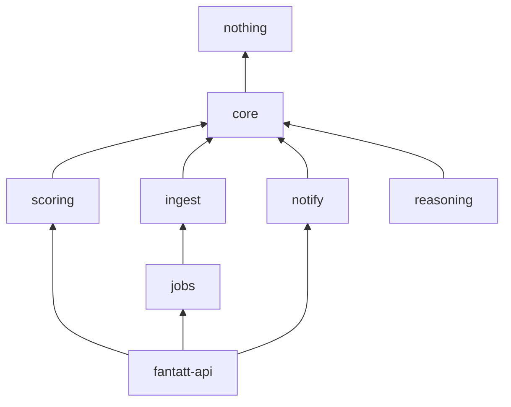
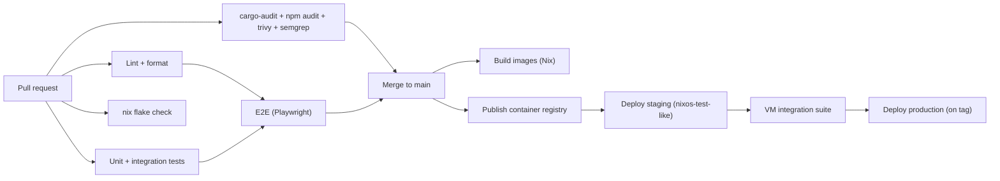

# Monorepo Structure and Toolchain

## 1. Layout

```
fantatt/
├── flake.nix                     # flake-parts entry: packages, checks, devShell, nixosModules
├── flake.lock
├── justfile                      # human-facing task list
├── Cargo.toml                    # workspace root
├── Cargo.lock
├── package.json                  # frontend workspace root
├── package-lock.json
├── README.md
├── CHANGELOG.md
├── LICENSE
│
├── crates/
│   ├── fantatt-core/             # domain types, invariants, ports
│   ├── fantatt-reasoning/        # rule engine + Oxigraph + eyeron integration (rudof arrives with G1.9)
│   ├── fantatt-scoring/          # pure scoring functions
│   ├── fantatt-ingest/           # FITET scraper and parsers
│   ├── fantatt-api/              # axum handlers, middleware, OpenAPI
│   ├── fantatt-jobs/             # scheduler and queue workers
│   ├── fantatt-notify/           # push and email fanout
│   ├── fantatt-obs/              # OTel wiring, metric registry
│   └── fantatt-config/           # layered config + validation
│
├── rules/                        # versioned rule bundles
│   ├── fantatt-core/1.4.0/...
│   └── ...
│
├── web/                          # React PWA
│   ├── src/
│   │   ├── app/                  # routing, providers
│   │   ├── components/           # design system
│   │   ├── features/             # league, squad, auction, tournament
│   │   ├── lib/                  # api client (generated), sse, pwa
│   │   └── styles/               # brandbook tokens
│   └── tests/
│
├── docs/                         # this documentation set
│   ├── adr/                      # architecture decision records
│   └── diagrams/                 # mermaid sources
│
├── nix/
│   ├── cargo.nix                 # crane-based Rust builder
│   ├── web.nix                   # frontend builder
│   ├── containers.nix            # layered images
│   └── modules/                  # NixOS module source
│
├── deploy/
│   ├── nixos/                    # NixOS configurations and module options
│   ├── serverless/               # Lambda Web Adapter + Terraform
│   ├── observability/            # collectors, dashboards, alerts
│   └── compose/                  # optional Docker Compose for non-Nix hosts
│
└── tests/
    ├── e2e/                      # Playwright browser flows
    ├── nixos/                    # nixosTest integration tests
    └── conformance/              # API contract tests
```

## 2. Rust workspace

`fantatt-core` depends on nothing external beyond `serde`, `thiserror`, and
`time`. Everything else builds on it.

```toml
[workspace]
members = ["crates/*"]
resolver = "3"

[workspace.dependencies]
axum = "0.8.9"
tokio = { version = "1", features = ["full"] }
sqlx = { version = "0.9.0", features = ["runtime-tokio", "postgres", "migrate", "macros"] }
oxigraph = "0.5.13"
eyeron = "0.9.2"
# rudof 0.1.12 is deferred to G1.9: it does not compile against the current
# releases of its shacl_ast/shacl_validation/srdf family (APIs it imports were
# removed), and pinning the whole family to 2024 releases would be dependency
# drift. It returns with the family pinned and a SHACL conformance test.
utoipa = "6.0.0"
webauthn-rs = "0.6.2"
oauth2 = "5.0.0"
openidconnect = "4.1.0"
tower-sessions = "0.15.0"
reqwest = { version = "0.13", default-features = false, features = ["rustls", "gzip", "h2"] }
tracing = "0.1"
tracing-opentelemetry = "0.34.0"
governor = "0.10.4"
validator = "0.21.0"
```

## 3. Layered dependency rule



`core` has no I/O. `reasoning`, `scoring`, and `ingest` are pure-of-framework.
Only `api`, `jobs`, and `notify` know about HTTP, the database, and the clock.

## 4. Build and toolchain (Nix)

`flake-parts` is the framework (not `flake-utils`, which the NixOS wiki no longer
recommends). `crane` 0.24.0 builds the Rust workspace incrementally with full
cargo dependency reuse; `rust-overlay` supplies toolchains.

| Task | Command |
| --- | --- |
| Enter dev shell | `nix develop` (or `direnv allow`) |
| Build everything | `nix build` |
| Run all checks | `nix flake check --all-systems` |
| Run all tests | `just test` |
| Format | `nix fmt` (nixfmt) + `cargo fmt` + `prettier` |
| Lint | `cargo clippy -- -D warnings`, `eslint` |
| Security | `just security` (semgrep, trivy, git-secrets, cargo-audit) |

Frontend builds use `buildNpmPackage` with `importNpmLock` (hermetic offline
npm installs from `package-lock.json`, no separate hash to maintain).

## 5. CI/CD (GitHub Actions)



Required status checks on PR: format, clippy, unit tests, integration tests,
contract tests, `cargo audit`, `npm audit`, trivy, semgrep, secret scan, and
`nix flake check`. Branches are protected; merges are squash commits in
conventional-commit form.

Tags trigger the release pipeline: version bump, changelog generation, image
build and push, deployment. Rollback is "deploy the previous Nix closure", which
is atomic and instant.

## 6. Task runner (`justfile`)

| Command | Purpose |
| --- | --- |
| `just` | List everything |
| `just dev` | Run API + web with watch |
| `just test` | Unit + integration |
| `just e2e` | Browser E2E against the local stack |
| `just nixos-test` | NixOS VM integration suite |
| `just rules` | Extract, run, and verify rule bundles |
| `just check` | Everything CI runs |
| `just security` | Security scans |
| `just docs` | Validate diagrams and OpenAPI |
| `just db-migrate` | Apply migrations |

## 7. Documentation discipline

- This `docs/` tree is the architecture source of truth; it describes the current
  state only.
- Every significant decision has an ADR in `docs/adr/`: context, decision,
  alternatives, consequences, verification status.
- API changes are made in the OpenAPI schema first, then the handler.
- The brandbook is a code artefact: design tokens in `web/src/styles/` are the
  executable form of `09-brandbook.md`, and a CI check compares the token list
  with the documented list.
