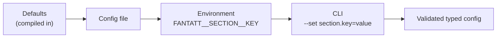

# Configuration

Nothing about the game lifecycle is hardcoded. Every duration, threshold, weight,
and endpoint is configuration, validated at startup and reloadable at runtime.

## 1. Configuration layers



Precedence, highest first: CLI, environment, file, defaults. The two later
layers of this document — runtime overrides through the admin API and
per-league settings — land with the gates that own them and sit above all four.

| Layer | Format | Used for |
| --- | --- | --- |
| Defaults | compiled-in TOML (`src/defaults.toml`) | Safe fallbacks for every key |
| File | TOML | Deployment profile |
| Environment | `FANTATT__SECTION__KEY` | Secrets and per-environment values |
| CLI | `--set section.key=value` | One-shot overrides in a deploy script |
| Runtime | Admin API / league settings | Lifecycle parameters without a deploy |
| Per-league | League settings table | Budget, lock mode, competitions, resell day |

Two environment variables steer the boot itself and are never settings:
`FANTATT__CONFIG_FILE` names the TOML file to read, and `FANTATT__ENV_FILE`
names a file of `KEY=VALUE` lines to load before anything else. Both are set
by a deployment; every other `FANTATT__` variable becomes a settings override,
with the section as the path and `__` as the separator (`FANTATT__SERVER__PORT`
sets `server.port`). An environment variable that names a secret field is
ignored by the loader, because a secret reaches the process only through a
literal in the environment.

The loader is the CLI front-end of the service:
`fantatt --config /etc/fantatt.toml --set server.port=8080`. An explicitly
named config file must exist, the default `fantatt.toml` is optional, and an
unreadable file or a malformed env-file line aborts the boot naming the file
and the line.

## 2. Schema

Every section of §2 below is a typed struct in `fantatt-config`, so a
deployment file is rejected while it is parsed rather than at first use. A
generated JSON Schema for editor validation is not produced yet. Key sections:

```toml
# Example deployment config
[app]
name = "Fantatt"
environment = "production"
locale = "it"
base_url = "https://fantatt.example.org"

[server]
bind = "127.0.0.1"
port = 8080
public_port = 443
request_body_limit_bytes = 1048576

[database]
url = "postgres://fantatt@/fantatt"
max_connections = 20
min_connections = 2
connect_timeout_seconds = 10

[knowledge_graph]
mode = "embedded-rocksdb"        # embedded-rocksdb | embedded-memory | service
path = "/var/lib/fantatt/kg"
snapshot_interval_seconds = 300
snapshot_target = "s3://fantatt-snapshots/kg"   # optional

[session]
idle_seconds = 2592000
absolute_seconds = 43200
cookie_name = "__Host-session"

[auth.google]
enabled = true
client_id = "..."
client_secret = "env:FANTATT__AUTH__GOOGLE__CLIENT_SECRET"
scopes = ["openid", "email", "profile"]
redirect_uri = "https://fantatt.example.org/api/v1/auth/oauth/google/callback"

[auth.passkey]
enabled = true
rp_id = "fantatt.example.org"
rp_origin = "https://fantatt.example.org"

[csrf]
enabled = true
header = "X-CSRF-Token"

[rate_limit]
store = "redis"                  # redis | memory
rules = { auth = "10/min per ip", bid = "20/min per user", search = "60/min per user" }

[ingest]
enabled = true
concurrency = 4
min_request_interval_ms = 750
source_base_url = "https://portale.fitet.org/"
regions = ["Trentino"]
discovery_interval_minutes = 30
matchday_interval_minutes = 5
classifica_interval_hours = 24
respect_robots = true

[email]
provider = "smtp"                # smtp | http-api | log
from = "Fantatt <noreply@fantatt.example.org>"

[storage]
provider = "s3"                  # s3 | filesystem
bucket = "fantatt"
endpoint = "https://s3.example.org"
region = "us-east-1"

[notifications]
push_enabled = true
vapid_public_key = "..."
vapid_private_key = "env:FANTATT__NOTIFICATIONS__VAPID_PRIVATE_KEY"

[observability]
otlp_endpoint = "http://127.0.0.1:4317"
service_name = "fantatt-api"
log_level = "info"
log_format = "json"

[rules]
active_bundle = "fantatt-core/1.4.0"
bundle_path = "/var/lib/fantatt/rules"
verify_proofs = true

[privacy]
policy_version = "2026-11-10"
cookie_notice_version = "2026-11-10"
deletion_grace_days = 30
minimum_age = 16

[live]
sse_enabled = true
heartbeat_seconds = 30
```

## 3. Secrets by reference

A value prefixed `env:` is resolved from the environment at startup, so a
config file carries only the name of the variable that holds the value. Every
field of the table below is typed as a reference: writing a literal into it is
a configuration error, and the abort names the key so the offending value can
be moved into the environment. Environment variables and the CLI may not set
these keys at all, which keeps the resolved value out of every layer that can
be printed or logged.

| Secret | Purpose | Required when |
| --- | --- | --- |
| `database.url` | Postgres connection | Always |
| `crypto.session_secret` | Session cookie / CSRF signing | Always |
| `auth.google.client_secret` | OAuth2 | `auth.google.enabled` |
| `notifications.vapid_private_key` | Web push signing | `notifications.push_enabled` |
| `storage.secret_key` | Object storage | `storage.provider = "s3"` |
| `observability.otlp_headers` | Telemetry auth | `observability.otlp_endpoint` is set |

Startup resolves every required reference and collects all the absent ones, so
one abort lists each missing key together with the variable that should hold
it. A resolved secret is a `Secret` value: it prints redacted, and only an
explicit `expose()` hands the material to the code that needs it.

Session and CSRF secrets are either random per boot (single node) or provided
(multi node, so nodes can validate each other's cookies).

## 4. Per-league configuration (organizer freedom)

| Category | Options |
| --- | --- |
| Ownership | exclusive or shared |
| Budget | any positive amount and unit |
| Competitions | Any mix of regions, tiers, genders, championship or tournament |
| Season | Year, start and end dates |
| Roster | Tier distribution (default 2+1 per tier), starters and bench counts, substitutions on/off |
| Lock | Submit-or-deadline / deadline-only; lock hour and timezone |
| Auction | Duration, soft-close window, minimum increments, bid visibility |
| Resell | Day of month, window length, manager-to-manager visibility |
| Scoring | Active rule bundle (from the published set), optional weekly prizes |
| Week one | Counted or excluded (default excluded) |
| Privacy | Public league page or invite-only |

A league may even opt into an **older rule bundle** (published and frozen), so
existing seasons never change mid-flight.

## 5. Swappable facades

Every external capability has a Rust trait and several implementations. The
facade is selected in config; code never branches on provider names.

| Facade | Implementations |
| --- | --- |
| `EmailSender` | `smtp` (lettre), `http-api` (Resend / Postmark / Mailgun / SES v2), `log` (development) |
| `ObjectStore` | `s3`, `filesystem` |
| `ReasoningEngine` | embedded Oxigraph + eyeron (rudof joins with G1.9) |
| `Leadership` | single-node (in-process) / Postgres advisory lock |
| `Queue` | Postgres LISTEN/NOTIFY, optional NATS |
| `MetricsBackend` | OTLP |
| `ScrapeSource` | FITET portal (default), with a trait that allows a second source |

Each facade has a `log` or `noop` implementation for tests and local
development, and each has an integration test in `tests/`.

## 6. Validation and reload

- Startup: the config is parsed into typed structs, cross-checked (for example,
  `session.cookie_name` must start with `__Host-` if `public_port` is 443), and
  rejected if invalid.
- Runtime: hot-reloadable settings (ingest cadence, log level, feature flags)
  apply without restart; structural settings (database, ports) require a restart
  and say so in the admin UI.
- Every runtime change is recorded in the audit log.

## 7. Feature flags

A per-league and global flag set, stored in config and the database, covering the
tournament predictor mode, auction resell, push notifications, and experimental
scoring features. Defaults are off for anything not yet covered by the E2E suite.
