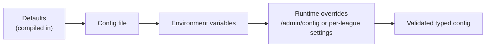

# Configuration

Nothing about the game lifecycle is hardcoded. Every duration, threshold, weight,
and endpoint is configuration, validated at startup and reloadable at runtime.

## 1. Configuration layers



Precedence: environment > file > default. Runtime overrides are highest but
require an entitlement, and every change is audited.

| Layer | Format | Used for |
| --- | --- | --- |
| Defaults | Rust `Default` impls | Safe fallbacks, documented in the schema |
| File | TOML | Deployment profile |
| Environment | `FANTATT__SECTION__KEY` | Secrets and per-environment values |
| Runtime | Admin API / league settings | Lifecycle parameters without a deploy |
| Per-league | League settings table | Budget, lock mode, competitions, resell day |

## 2. Schema

The configuration has a generated JSON Schema so editors validate it and the
server rejects it early. Key sections:

```toml
# Example deployment config
[app]
name = "Fantatt"
environment = "production"
locale = "it"
base_url = "https://fantatt.example.org"

[server]
bind = "127.0.0.1"
port = 8080
public_port = 443
request_body_limit_bytes = 1048576

[database]
url = "postgres://fantatt@/fantatt"
max_connections = 20
min_connections = 2
connect_timeout_seconds = 10

[knowledge_graph]
mode = "embedded-rocksdb"        # embedded-rocksdb | embedded-memory | service
path = "/var/lib/fantatt/kg"
snapshot_interval_seconds = 300
snapshot_target = "s3://fantatt-snapshots/kg"   # optional

[session]
idle_seconds = 2592000
absolute_seconds = 43200
cookie_name = "__Host-session"

[auth.google]
enabled = true
client_id = "..."
client_secret = "env:FANTATT__AUTH__GOOGLE__CLIENT_SECRET"
scopes = ["openid", "email", "profile"]
redirect_uri = "https://fantatt.example.org/api/v1/auth/oauth/google/callback"

[auth.passkey]
enabled = true
rp_id = "fantatt.example.org"
rp_origin = "https://fantatt.example.org"

[csrf]
enabled = true
header = "X-CSRF-Token"

[rate_limit]
store = "redis"                  # redis | memory
rules = { auth = "10/min per ip", bid = "20/min per user", search = "60/min per user" }

[ingest]
enabled = true
concurrency = 4
min_request_interval_ms = 750
source_base_url = "https://portale.fitet.org/"
regions = ["Trentino"]
discovery_interval_minutes = 30
matchday_interval_minutes = 5
classifica_interval_hours = 24
respect_robots = true

[email]
provider = "smtp"                # smtp | http-api | log
from = "Fantatt <noreply@fantatt.example.org>"

[storage]
provider = "s3"                  # s3 | filesystem
bucket = "fantatt"
endpoint = "https://s3.example.org"
region = "us-east-1"

[notifications]
push_enabled = true
vapid_public_key = "..."
vapid_private_key = "env:FANTATT__NOTIFICATIONS__VAPID_PRIVATE_KEY"

[observability]
otlp_endpoint = "http://127.0.0.1:4317"
service_name = "fantatt-api"
log_level = "info"
log_format = "json"

[rules]
active_bundle = "fantatt-core/1.4.0"
bundle_path = "/var/lib/fantatt/rules"
verify_proofs = true

[privacy]
policy_version = "2026-11-10"
cookie_notice_version = "2026-11-10"
deletion_grace_days = 30
minimum_age = 16

[live]
sse_enabled = true
heartbeat_seconds = 30
```

## 3. Secrets by reference

Any value prefixed `env:` is resolved from the environment at startup. Missing
required values abort startup with a message naming the exact key.

| Secret | Purpose |
| --- | --- |
| `database.url` | Postgres connection |
| `auth.google.client_secret` | OAuth2 |
| `notifications.vapid_private_key` | Web push signing |
| `storage.secret_key` | Object storage |
| `observability.otlp_headers` | Telemetry auth |
| `crypto.session_secret` | Session cookie / CSRF signing |

Session and CSRF secrets are either random per boot (single node) or provided
(multi node, so nodes can validate each other's cookies).

## 4. Per-league configuration (organizer freedom)

| Category | Options |
| --- | --- |
| Ownership | exclusive or shared |
| Budget | any positive amount and unit |
| Competitions | Any mix of regions, tiers, genders, championship or tournament |
| Season | Year, start and end dates |
| Roster | Tier distribution (default 2+1 per tier), starters and bench counts, substitutions on/off |
| Lock | Submit-or-deadline / deadline-only; lock hour and timezone |
| Auction | Duration, soft-close window, minimum increments, bid visibility |
| Resell | Day of month, window length, manager-to-manager visibility |
| Scoring | Active rule bundle (from the published set), optional weekly prizes |
| Week one | Counted or excluded (default excluded) |
| Privacy | Public league page or invite-only |

A league may even opt into an **older rule bundle** (published and frozen), so
existing seasons never change mid-flight.

## 5. Swappable facades

Every external capability has a Rust trait and several implementations. The
facade is selected in config; code never branches on provider names.

| Facade | Implementations |
| --- | --- |
| `EmailSender` | `smtp` (lettre), `http-api` (Resend / Postmark / Mailgun / SES v2), `log` (development) |
| `ObjectStore` | `s3`, `filesystem` |
| `ReasoningEngine` | embedded Oxigraph + eyeron (rudof joins with G1.9) |
| `Leadership` | single-node (in-process) / Postgres advisory lock |
| `Queue` | Postgres LISTEN/NOTIFY, optional NATS |
| `MetricsBackend` | OTLP |
| `ScrapeSource` | FITET portal (default), with a trait that allows a second source |

Each facade has a `log` or `noop` implementation for tests and local
development, and each has an integration test in `tests/`.

## 6. Validation and reload

- Startup: the config is parsed into typed structs, cross-checked (for example,
  `session.cookie_name` must start with `__Host-` if `public_port` is 443), and
  rejected if invalid.
- Runtime: hot-reloadable settings (ingest cadence, log level, feature flags)
  apply without restart; structural settings (database, ports) require a restart
  and say so in the admin UI.
- Every runtime change is recorded in the audit log.

## 7. Feature flags

A per-league and global flag set, stored in config and the database, covering the
tournament predictor mode, auction resell, push notifications, and experimental
scoring features. Defaults are off for anything not yet covered by the E2E suite.
