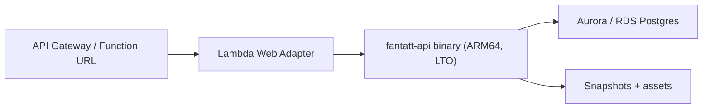
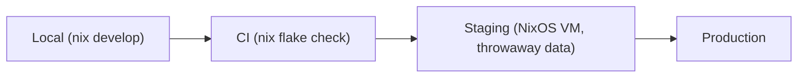

# Deployment

One binary, one container image, one NixOS module, and one serverless recipe.
The deployment target is configuration, not code.

## 1. Options compared

| Target | Best for | Cost profile | Lock-in |
| --- | --- | --- | --- |
| NixOS module (self-host) | Full control, cheapest, GDPR-safe | Server cost only | None |
| VM provider (Fly.io) | Always-on + managed Postgres | ~$3–8/month at this scale | Low |
| Serverless (Lambda + Web Adapter) | Spiky traffic, zero idle cost | Pay per request | Medium |
| Cloudflare Workers | Edge fan-out, cheap SSE | $5/month minimum | Medium |

The primary recommendation is a single always-on VM (the API needs SSE and
Postgres anyway), with the serverless path retained as a burst tier and a
compile-time option. Both images come from the same Nix build.

## 2. NixOS module

### 2.1 Usage

```nix
{
  inputs.fantatt.url = "github:SamueleFacenda/fantatt";

  outputs = { self, nixpkgs, fantatt, ... }: {
    nixosConfigurations.fantatt = nixpkgs.lib.nixosSystem {
      system = "x86_64-linux";
      modules = [
        fantatt.nixosModules.fantatt
        {
          services.fantatt = {
            enable = true;
            package = fantatt.packages.x86_64-linux.default;
            domain = "fantatt.example.org";
            email = "admin@example.org";

            database.createLocally = true;
            storage.createLocally = true;
            observability.createLocally = true;

            settings = {
              ingest.regions = [ "Trentino" ];
              ingest.concurrency = 4;
              notifications.push_enabled = true;
            };

            secrets = {
              googleClientSecretFile = "/run/secrets/google_client_secret";
              vapidPrivateKeyFile = "/run/secrets/vapid_key";
            };
          };
        }
      ];
    };
  };
}
```

The module wires up the API service, the ingest worker, the scheduler, the
notification service, TLS (via nginx or ACME), the firewall, the system users,
and opt-in local instances of Postgres, Valkey, MinIO, Prometheus, Loki, Alloy,
Tempo, and Grafana.

### 2.2 Hardened service definition

```nix
systemd.services.fantatt-api.serviceConfig = {
  Type = "notify";
  Restart = "always";
  RestartSec = 3;
  WatchdogSec = 30;

  DynamicUser = true;                      # implies NoNewPrivileges + ProtectSystem=strict
  StateDirectory = "fantatt-api";
  RuntimeDirectory = "fantatt-api";
  WorkingDirectory = "/var/lib/fantatt-api";

  NoNewPrivileges = true;
  RestrictSUIDSGID = true;
  RestrictRealtime = true;
  RestrictNamespaces = true;
  LockPersonality = true;
  RestrictAddressFamilies = [ "AF_INET" "AF_INET6" "AF_UNIX" ];
  SystemCallArchitectures = "native";
  SystemCallFilter = [ "@system-service" "~@privileged" "~@resources" "~@obsolete" ];
  SystemCallErrorNumber = "EPERM";
  MemoryDenyWriteExecute = true;           # Rust is AOT: safe and desirable here
  ProtectSystem = "strict";
  ProtectHome = true;
  PrivateTmp = true;
  PrivateDevices = true;
  ProtectKernelTunables = true;
  ProtectKernelModules = true;
  ProtectKernelLogs = true;
  ProtectControlGroups = "strict";
  ProtectClock = true;
  ProtectHostname = true;
  ProtectProc = "invisible";
  ProcSubset = "pid";
  DevicePolicy = "closed";
  CapabilityBoundingSet = "";              # drop every capability
  AmbientCapabilities = "";
  UMask = "0077";
};
```

`nix flake check` runs a `nixosTest` that boots the full stack in a VM and
verifies the API comes up, scrapes, scores, and serves. A hardening regression
(an option becoming too strict for the binary) fails that test, not production.

`systemd-analyze security fantatt-api.service` is run in CI and the score is
reported, so regressions in hardening are visible.

### 2.3 Secrets injection

```nix
systemd.services.fantatt-api.serviceConfig.LoadCredential = [
  "google_client_secret:/run/secrets/google_client_secret"
];
```

Root-owned 0400, never in the Nix store, never in the environment of child
processes.

## 3. Containers

```nix
pkgs.dockerTools.buildLayeredImage {
  name = "ghcr.io/samuelefacenda/fantatt";
  tag = "1.4.0";
  contents = [ fantatt-api fantatt-jobs fantatt-ingest cacert ];
  config = {
    Cmd = [ "${fantatt-api}/bin/fantatt-api" "serve" ];
    User = "65534";
    Env = [ "FANTATT__SERVER__BIND=0.0.0.0" ];
  };
  extraCommands = ''
    mkdir -p var/lib/fantatt
    chmod 0755 var/lib/fantatt
  '';
}
```

Layered (one layer per store path) for efficient pulls. `copyToRoot` is used, not
the deprecated `contents` argument in new expressions. Images run as non-root and
are scanned by trivy in CI.

## 4. Serverless recipe



- The same binary behind the **AWS Lambda Web Adapter** (`1.1.0`, `aws` org) —
  no code change, no `lambda_runtime` dependency in the domain.
- Measured Rust cold starts on Lambda ARM64 are 18–22 ms with a ~885 kB binary,
  which meets the 500 ms warm / 2 s cold SLO comfortably.
- Terraform (or OpenTofu) definitions are in `deploy/serverless/`, so the
  infrastructure is reviewable and reproducible.
- The queue and scheduler run either inside the same function (event-driven) or
  on a small always-on job runner, depending on cost preference.

Workers, Fly, and Railway alternatives are documented with measured pricing in
`docs/adr/0005-hosting.md`; the choice can be switched by changing the target,
not the code.

## 5. Environments



| Environment | Data | Purpose |
| --- | --- | --- |
| Local | Recorded FITET fixtures | Development |
| CI | Generated | Correctness |
| Staging | Live scrape, disposable | Full-stack verification |
| Production | Real | Service |

## 6. CI/CD pipeline detail

| Stage | Steps |
| --- | --- |
| Validate | `nix fmt --check`, clippy `-D warnings`, eslint, prettier, typecheck |
| Test | Rust unit + integration, frontend unit, rule conformance, API contract |
| Secure | `cargo audit`, `npm audit`, trivy, semgrep, secret scan |
| Build | `nix build .#packages.x86_64-linux.default`, `.#checks` |
| E2E | Playwright against the staging stack |
| VM | `nixosTest` full-stack suite |
| Publish | Push layered images to ghcr.io (tagged and immutable) |
| Deploy | On tag: staging first, then production after smoke checks |
| Rollback | Redeploy the previous Nix closure |

Every stage gates the next; a merge to `main` is only possible with all checks
green. Releases are tags (`v1.4.0`), never branch tips.

## 7. Backup and disaster recovery

| Item | Method | RPO |
| --- | --- | --- |
| Postgres | WAL archiving to object storage + nightly basebackup | ≤ 5 min |
| Knowledge graph | Periodic snapshots to object storage; rebuilt from the ingest ledger otherwise | ≤ 5 min |
| Object storage | Versioned bucket | — |
| Config and secrets | Git for config; a secrets vault for credentials | — |
| Audit log | Never pruned; exported monthly |

Recovery is documented as a runbook and tested in the NixOS VM suite: restore a
backup into a fresh VM, verify scoring reproduces identical numbers.

## 8. Observability deployment

The module can bring up the whole stack locally:

```nix
services.fantatt.observability.createLocally = true;
```

which enables `services.opentelemetry-collector`, `services.tracing.tempo`,
`services.loki` fed by `services.alloy`, `services.prometheus`, and
`services.grafana`, with provisioned datasources and dashboards. Grafana listens
on localhost by default and is exposed through the reverse proxy with SSO when
desired. `deploy/observability/` holds the dashboards and alert rules as code.

## 9. Scaling

| Layer | Scales how |
| --- | --- |
| API | Stateless; scale horizontally behind the load balancer |
| Session/rate limit | Redis-compatible store shared across nodes |
| Knowledge graph | Embedded per node; single writer for ingest, snapshots shared |
| Ingest | Independent workers, deduplicated by content hash |
| Queue | Postgres `LISTEN/NOTIFY` up to moderate load; NATS JetStream beyond |
| Database | Read replicas for standings queries |

The design deliberately has no single component that cannot be replicated or
restarted from the authoritative store.
