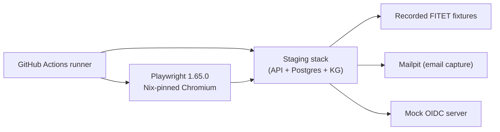

# Testing Strategy

Four levels, all automated, all in CI.

## 1. Test pyramid

| Level | Scope | Count target | Runs |
| --- | --- | --- | --- |
| Unit | Pure functions, rules, parsers, formatters | Thousands | Every PR |
| Integration | API + database + reasoning + queue | Hundreds | Every PR |
| Contract | OpenAPI conformance, rule conformance | Dozens | Every PR |
| E2E (browser) | Full user journeys | ~25 flows | Every PR |
| E2E (VM) | Deployed stack, multi-node, concurrency | ~15 scenarios | Every merge |
| Performance | Load, latency, cold start | Benchmarks | Weekly + release |
| Security | Authorisation matrix, headers, scans | Exhaustive roles | Every PR |

## 2. Unit testing (Rust)

| Target | Approach |
| --- | --- |
| `fantatt-core` | Invariant tests: every INV-* from `02-domain-model.md` has a test |
| `fantatt-scoring` | Golden files for every spec example in `05-scoring-spec.md` §8, plus boundary cases (0-2 comeback, 3-3 decider, doubles, absence) |
| `fantatt-ingest` | Recorded HTML fixtures parsed to expected canonical records; no network |
| `fantatt-reasoning` | Rule bundles evaluated against golden graphs with proof verification |
| Config | Config validation, including every invalid combination |

Property-based tests (`proptest`) for: roster generators (never generate an
invalid roster unless deliberately corrupting), rating multipliers (monotonic in
opponent rating), money arithmetic (no negative budgets), and pagination cursors.

Coverage gate: 80% lines, 100% of rules and invariants.

`just coverage` reports the line coverage of `fantatt-core`. The dev shell
supplies `llvm-profdata`/`llvm-cov` from `llvmPackages_23` (the LLVM release
inside the pinned `rustc` 1.99.1) and exports `LLVM_COV`/`LLVM_PROFDATA`, so
the tools are always available. A toolchain whose LLVM version predates the
profile format written by the pinned `rustc` fails with a raw-profile version
mismatch.

Database-backed tests use `fantatt-test-support`: each test boots a private
`initdb` instance on a unix socket in a temp directory and migrates it, so no
test ever touches the developer's local database or needs a running service.
The harness needs the dev shell (`initdb`/`postgres` from the pinned nixpkgs)
and runs identically in CI. The committed offline query data in `.sqlx/` keeps
`cargo check` hermetic; `just db-offline-check` (part of `just check`) fails
when it drifts from `migrations/`.

## 3. Rule conformance

Every rule bundle ships tests inside it:

```
rules/fantatt-core/1.4.0/
  tests/
    roster/valid_15.ttl          in graph
    roster/valid_15.expected      derived facts
    roster/ineligible_player.ttl
    roster/ineligible_player.expected
    scoring/d1_away.ttl
    scoring/d1_away.expected
```

`just rules` evaluates each: load the graph, run the bundle, diff the derived
facts against expectations, and verify the proof certificate. A rule change
without a matching expected-file update fails CI. This is what keeps the scoring
spec honest.

## 4. API contract tests

- The OpenAPI schema is generated at build time.
- A conformance test suite drives every endpoint against a test instance,
  validating request and response against the schema.
- An exhaustive **authorisation matrix test** enumerates role × route and
  asserts the expected status; a new undeclared capability fails the build.
- Error-shape tests assert every 422 names a rule.

## 5. Browser E2E (Playwright)

### 5.1 Architecture



- Chromium is provided by Nix (not Playwright's bundled download) so the browser
  itself is in the trusted, hash-pinned supply chain.
- Email is captured with Mailpit; Google OAuth is replaced with a mock OIDC
  server that emits the same claims shape, including `picture`.
- Each run seeds a fresh database, runs migrations, and applies fixtures.

### 5.2 Flows

| Flow | Assertions |
| --- | --- |
| First visit and install | Manifest parses, service worker registers, maskable icon present, install prompt offered |
| Google login | Profile name, email, and avatar populate from the mock claims |
| Passkey registration and login | Virtual authenticator completes registration; login requires no password |
| League creation | Budget, competitions, ownership mode saved; invite link generated |
| Join by link | Link opens login, then joins; roster page reachable |
| Roster build | 15 slots filled; invalid tier choice shows the named rule; submit locks |
| Roster validation | Budget, exclusivity, and duplicate violations each return the rule name |
| Bench substitution | A starter marked absent produces the tier-matched bench substitution |
| Live matchday | Fixture publishes results; SSE updates appear; offline banner on network cut |
| Offline behaviour | With the network cut, cached standings render; writes queue and replay |
| Auction bid | Bid accepted, outbid push received, timer extends on soft-close |
| Auction rejection | Over-bid attempt returns the rule trace and changes nothing |
| Resell | Manager-to-manager sale completes; both squads update |
| Tournament prediction | Bracket picks saved; points awarded per accuracy |
| Profile edit | Description and avatar persist; visible to other members |
| GDPR export | Export file downloads and contains all personal data |
| Account deletion | Deletion scheduled; login blocked; purge after grace |
| Accessibility | axe-core reports zero violations on every route |
| PWA update | A new service worker triggers the update prompt; accepting reloads |
| Installability on mobile | 390×844 viewport flows pass with touch targets ≥ 44 px |

### 5.3 Viewports

`390×844` (phone), `768×1024` (tablet), `1440×900` (desktop). Every flow runs on
the phone viewport; a representative subset runs on all three.

## 6. NixOS VM integration tests

```nix
{
  name = "fantatt-full-stack";
  nodes = {
    server = { config, pkgs, ... }: {
      imports = [ fantatt.nixosModules.fantatt ];
      services.fantatt.enable = true;
    };
  };
  testScript = ''
    start_all()
    server.wait_for_unit("fantatt-api.service")
    server.wait_for_open_port(8080)
    server.succeed("systemd-analyze security fantatt-api.service | grep -E 'Overall exposure' >&2")
    server.succeed("curl -sSf http://127.0.0.1:8080/healthz >&2")
    '';
}
```

What the VM suite proves that a container cannot:

| Scenario | Why a VM |
| --- | --- |
| Hardened systemd options | Namespacing and syscall filters need a real kernel |
| TLS and the reverse proxy | Certificates and ALPN |
| Backup and restore | Real Postgres with WAL archiving |
| Multi-node concurrency | Two API nodes sharing Postgres and the queue; auction serialization across processes |
| Ingest from a recorded source | A local HTTP server replaying fixtures, so no external dependency |
| Service restart resilience | Kill the API mid-derivation; verify consistency |
| Upgrades | Deploy N+1 over N; verify no data loss and identical scores |

Race conditions in auctions are tested with many concurrent bid processes and a
post-condition assertion: exactly one bid per lot, and no budget ever exceeded.

## 7. Performance tests

| Test | Target |
| --- | --- |
| 200 concurrent managers reading standings | p95 < 300 ms |
| 50 concurrent bids on 20 lots | No lost update, serialized, p95 < 1 s |
| Full season recompute (100 leagues, 500 players) | < 60 s |
| Bootstrap of a VM to first request | < 30 s |
| Cold start on Lambda | < 2 s |

Benchmarks run weekly on a schedule and on every release candidate; regressions
block the release.

## 8. Security tests

| Test | Detail |
| --- | --- |
| Authorisation matrix | role × route exhaustive |
| CSRF | Every mutating route rejects a missing or wrong token |
| Cookie flags | `__Host-`, `HttpOnly`, `Secure`, `SameSite` verified from a real browser |
| CSP | Header present with a nonce; no report violations in a clean run |
| Header assertions in E2E | HSTS, `X-Content-Type-Options`, `frame-ancestors` |
| XSS probes | Script payloads in names and descriptions render as text |
| IDOR | A manager from league A cannot read or write league B objects |
| Supply chain | `cargo audit`, `npm audit`, trivy on every build |

## 9. Test data management

| Fixture | Source |
| --- | --- |
| `matches.json` (1085 matches) | The legacy prototype, promoted to a golden fixture |
| Player ratings | Recorded classifica snapshots |
| HTML pages | Recorded raw responses from the prototype era, plus fresh captures for new pages |
| Users, leagues, squads | Generated factories with deterministic seeds |

Fixtures are versioned; a parser that needs a new fixture is a signal that the
source changed and must be reported.
