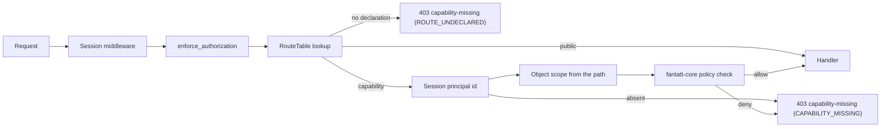

# Authorization Matrix

Status: active | Refines: [07-api-spec.md](07-api-spec.md), [10-security.md](10-security.md) | Audience: development agents, client

This document describes the implemented authorization model of G0.7: the
capability model in `fantatt-core`, the route declarations in `fantatt-api`,
the authorize middleware between the session layer and the handlers, and the
seeded test that walks every role against every declared route. It covers
current state only.

## 1. Roles and capabilities

`fantatt-core` defines the roles of `docs/07-api-spec.md` §13; the spellings
match the `fantatt.memberships.role` values of the migration set. A principal
is the authenticated user id, the platform grant from configuration, and the
league roles read from the database.

| Role | Scope | Grant |
| --- | --- | --- |
| `superadmin` | Platform | Every capability, including ruleset publication and user role assignment |
| `league_admin` | League | League settings, members, join requests, squad unlocks, resell windows |
| `collaborator` | League | Rosters and invites; cannot change ownership mode or delete the league |
| `manager` | League | Own squad and bids |
| `member` | League | League reads and own account |

Each route declares one capability; the policy is default-deny, so an
undeclared capability never reaches a handler:

| Capability | Who holds it against the route's object |
| --- | --- |
| `public` | Everyone, including anonymous callers |
| `session` | Any authenticated principal; an account object only its own user or the superadmin |
| `league:read` | Every league role, and the superadmin |
| `league:write` | `league_admin`, and the superadmin |
| `rosters:write` | `league_admin` and `collaborator`, and the superadmin |
| `squad:own` | `league_admin` and `manager`, and the superadmin |
| `users:read`, `users:write:roles`, `platform:admin` | The superadmin only, on a platform object |

The superadmin grant is an explicit list in configuration
(`[authz] superadmins`, `docs/12-configuration.md` §2); account creation grants
nothing. A membership row with role `SUPERADMIN` carries the same platform
grant inside its league, matching the database check constraint.

## 2. Route declarations

Routes register through `fantatt-api::authz`, which pairs every handler with a
guard: a capability and the object it acts on. The guard is a required
argument of the registration functions (`authz::get`, `authz::post`,
`authz::put`, `authz::delete`), and `DeclaredRouter` records one declaration
per route in a `RouteTable`. A registration therefore cannot compile without a
capability, and adding an endpoint without declaring one fails the build.

```rust
DeclaredRouter::new()
    .route(
        "/api/v1/admin/players/reconciliation",
        authz::get(queue, authz::guard(Capability::PlatformAdmin, authz::platform())),
    )
    .build()
```

A mutating admin route layers CSRF enforcement on top of its declaration, the
way the session route does: the middleware wraps the method router before
`DeclaredRoute` records the guard.

Object scopes resolve from the matched path: `authz::platform()`,
`authz::league("league_id")` (the object is the league named by the path
parameter), and `authz::account("user_id")` (the object is the user named by
the path parameter). The shell routes of `docs/20-api-shell.md` all declare
`public`; the first capability-gated routes are the identity reconciliation
admin routes of `docs/07-api-spec.md` §12, which declare `platform:admin` and
answer 403 problem+json per route in the OpenAPI document.

## 3. The authorize middleware

`authz::enforce_authorization` runs as route middleware inside the session
layer, between the absolute-lifetime check and the rate limiter:



The principal resolves per request: the superadmin flag from the configuration
list, league roles from `fantatt.memberships` (`state = 'ACTIVE'`) when the
route's object is a league. The policy itself is the pure
`fantatt_core::authz::authorize` function; the middleware maps its `Deny` to a
403 problem+json with `code` and, for a capability denial, `details.capability`
naming the missing one. Every denial logs one structured line; audit rows on
denial land with the audit chain of G2.4.

## 4. Default-deny guard

A matched route without a declaration is denied before its handler runs
(`ROUTE_UNDECLARED`), which is what the negative-control test exercises: a
route registered on the raw axum router, beside the declared ones, answers 403
for every caller including the superadmin. axum 0.8 exposes no enumeration of a
live router, so the compile-time capability requirement, this runtime guard,
and the negative-control test together carry the guarantee; see ADR-0011.

## 5. The matrix test

`crates/fantatt-api/tests/authorization_matrix.rs` boots its own shell around
a router built from the same declared builder, carrying representative
object-scoped routes: a league read, an invitation, a squad submission, the
admin user list, role assignment, the identity ambiguity queue, and
own-account preferences. Each test seeds a fresh ephemeral Postgres, mints a
session through `GET /auth/csrf`, writes the principal id into the session
data, and walks anonymous callers plus each role against the routes, asserting
allow/deny per §1: anonymous callers reach only public routes, a member reads
its league but cannot invite or submit, a collaborator invites but cannot
submit, only the superadmin reaches the admin surface, a session route serves
its own account and refuses another's, and the undeclared route denies
everyone.

## 6. Configuration

`[authz]` holds one key, `superadmins`, a list of user ids set as a config
file entry or a comma-separated `FANTATT__AUTHZ__SUPERADMINS` variable
(`docs/12-configuration.md` §2 and §3). Startup validation rejects an entry
that does not name a user id.

## 7. Deferred

- Audit-log rows on denial, with the append-only hash chain of G2.4; the deny
  path logs a structured event until then.
- Reconciling `MembershipRole` (owner/manager) with the five-role capability
  model, when league lifecycle work needs one role type (G2.4).